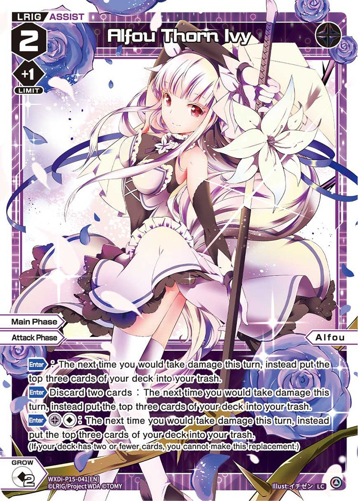

# Alfou Thorn Ivy

## Thông tin lá

| Trường | Giá trị |
| --- | --- |
| Mã in | WXDi-P15-041[EN] |
| Set | WXDi-P15[EN] |
| Số thứ tự | 041 |
| Loại thẻ | ASSIST LRIG |
| Vị trí | LRIG Deck |
| Số bản | — (set booster, không áp dụng) |
| Màu | Đen |
| Độ hiếm | LC,LC(P) |
| Minh họa | イチゼン |
| Level | 2 |
| Limit | 1 |
| Power | 0 |
| LRIG type / Class | Alfou |
| Team / Master | — |
| Cost | — |
| Grow cost | 《C》×２ |
| Use timing | Main Phase / Attack Phase |
| Life Burst | Không |

## Card text chính thức

[Enter]: The next time you would take damage this turn, instead put the top three cards of your deck into your trash.
[Enter] Discard two cards: The next time you would take damage this turn, instead put the top three cards of your deck into your trash.
[Enter] {Black} {Colorless}: The next time you would take damage this turn, instead put the top three cards of your deck into your trash.
(If your deck has two or fewer cards, you cannot make this replacement.)

## Power text / Life Burst

—

## Ghi chú minh họa
Artist: イチゼン. Ảnh LC được tải từ Card List tiếng Anh.

## FAQ chính thức

**Q. What happens if I trigger all three of the [Enter] abilities?**
A. The next and the next after and the next after that, for a total of three times damage is prevented; if one of the three is applied to prevent damage, no damage is incurred, so the remaining two “the next time you would take damage” carries over to the next damage. This can be done two more times for a total of three preventions.

**Q. I resolved all three of the [Enter] abilities, but the next time I took damage, I couldn't replace it because I had less than three cards in my deck, so I took the damage. If I then refresh the deck to get the cards back to my deck, may I replace the next damage?**
A. No, you cannot; from all three effects, “the next time you would take damage” is when the damage is first taken without being replaced. This effect does not apply to subsequent damage.

## Ảnh biến thể

- [LC(P)](../images/WXDi-P15-041P-EN.jpg)

## Nguồn
[Card List/FAQ chính thức](https://www.takaratomy.co.jp/products/en.wixoss/card/card.html?card_no=WXDi-P15-041%5BEN%5D ) · [Ảnh thẻ](https://www.takaratomy.co.jp/products/en.wixoss/card/thumb/WXDi-P15-041%5BEN%5D.jpg)
