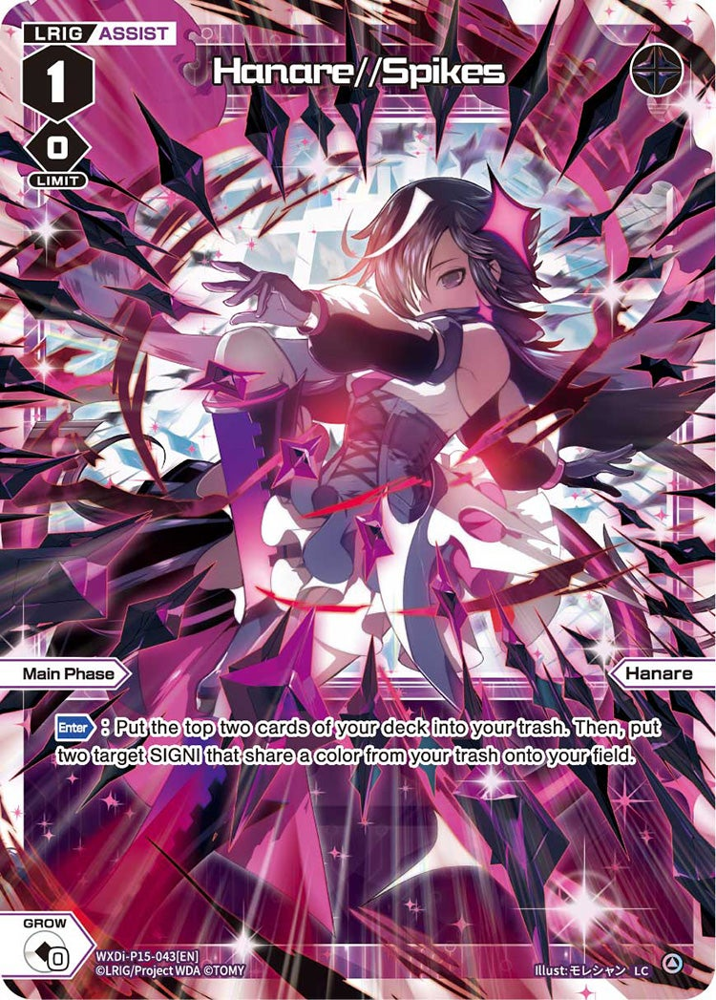

# Hanare//Spikes

## Thông tin lá

| Trường | Giá trị |
| --- | --- |
| Mã in | WXDi-P15-043[EN] |
| Set | WXDi-P15[EN] |
| Số thứ tự | 043 |
| Loại thẻ | ASSIST LRIG |
| Vị trí | LRIG Deck |
| Số bản | — (set booster, không áp dụng) |
| Màu | Đen |
| Độ hiếm | LC,LC(P) |
| Minh họa | モレシャン |
| Level | 1 |
| Limit | 0 |
| Power | 0 |
| LRIG type / Class | Hanare |
| Team / Master | — |
| Cost | — |
| Grow cost | 《C》×０ |
| Use timing | Main Phase |
| Life Burst | Không |

## Card text chính thức

[Enter]: Put the top two cards of your deck into your trash. Then, put two target SIGNI that share a color from your trash onto your field.

## Power text / Life Burst

—

## Ghi chú minh họa
Artist: モレシャン. Ảnh LC được tải từ Card List tiếng Anh.

## FAQ chính thức

**Q. What happens if I put each of the SIGNI with the [Enter] ability into the field?**
A. Those [Enter] abilities can be triggered in any order.

**Q. May I target two 《Servant #》 as “two target SIGNI that share a color”?**
A. No, it cannot. 《Servant #》 has [Multi Ener], but [Multi Ener] does not change the color of the card itself. Colorless has no color, so even if both SIGNI are colorless, they that not share a color.

**Q. What happens if there are no “wo target SIGNI that share a color” and only one SIGNI in its owner's trash?**
A. If two SIGNI that meet the conditions cannot be targeted, none can be targeted and none will be put into the field.

**Q. In the [Enter] ability, may I put two cards from the top of my deck into the trash and then target SIGNI?**
A. Yes, you can. If you target after the “then” in the text, you do not target at the time of trigger, but rather after you have finished the process up to before the “then” and then target it when the process actually comes to that text.

**Q. What happens if I target two SIGNI that meet the conditions, but there is only one empty SIGNI zone, or if the limit is exceeded if I put two SIGNI?**
A. In that case, only one target SIGNI will be put into the field, and the other will remain in its owner's trash.

## Ảnh biến thể

- [LC(P)](../images/WXDi-P15-043P-EN.jpg)

## Nguồn
[Card List/FAQ chính thức](https://www.takaratomy.co.jp/products/en.wixoss/card/card.html?card_no=WXDi-P15-043%5BEN%5D ) · [Ảnh thẻ](https://www.takaratomy.co.jp/products/en.wixoss/card/thumb/WXDi-P15-043%5BEN%5D.jpg)
