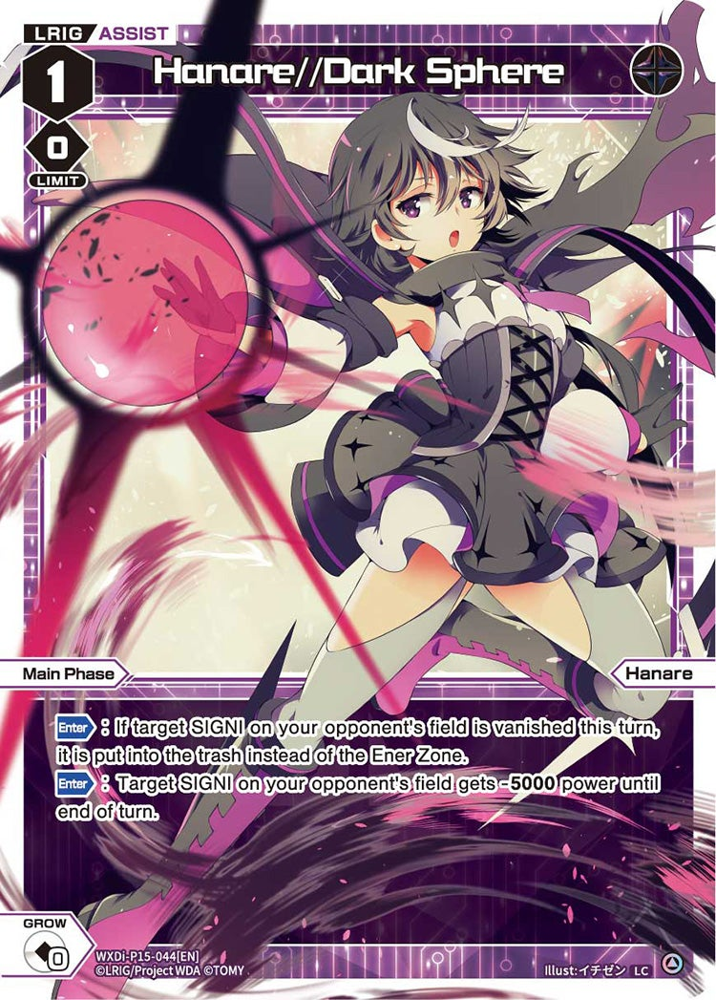

# Hanare//Dark Sphere

## Thông tin lá

| Trường | Giá trị |
| --- | --- |
| Mã in | WXDi-P15-044[EN] |
| Set | WXDi-P15[EN] |
| Số thứ tự | 044 |
| Loại thẻ | ASSIST LRIG |
| Vị trí | LRIG Deck |
| Số bản | — (set booster, không áp dụng) |
| Màu | Đen |
| Độ hiếm | LC,LC(P) |
| Minh họa | イチゼン |
| Level | 1 |
| Limit | 0 |
| Power | 0 |
| LRIG type / Class | Hanare |
| Team / Master | — |
| Cost | — |
| Grow cost | 《C》×０ |
| Use timing | Main Phase |
| Life Burst | Không |

## Card text chính thức

[Enter]: If target SIGNI on your opponent's field is vanished this turn, it is put into the trash instead of the Ener Zone.
[Enter]: Target SIGNI on your opponent's field gets -5000 power until end of turn.

## Power text / Life Burst

—

## Ghi chú minh họa
Artist: イチゼン. Ảnh LC được tải từ Card List tiếng Anh.

## FAQ chính thức

**Q. If I resolved the first [Enter] ability targeting SIGNI with power 5000 or less, and then use the second [Enter] ability to get it power -5000, does it put into its owner's trash?**
A. Yes, it is a vanishing of Rule-based action due to power 0 or less, and is put into its owner's trash, not the Ener zone.

## Ảnh biến thể

- [LC(P)](../images/WXDi-P15-044P-EN.jpg)

## Nguồn
[Card List/FAQ chính thức](https://www.takaratomy.co.jp/products/en.wixoss/card/card.html?card_no=WXDi-P15-044%5BEN%5D ) · [Ảnh thẻ](https://www.takaratomy.co.jp/products/en.wixoss/card/thumb/WXDi-P15-044%5BEN%5D.jpg)
