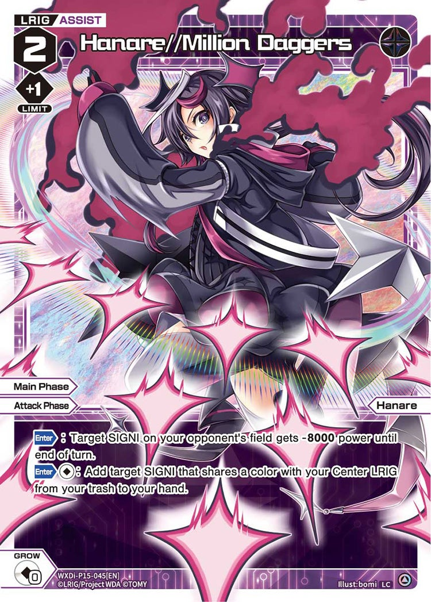

# Hanare//Million Daggers

## Thông tin lá

| Trường | Giá trị |
| --- | --- |
| Mã in | WXDi-P15-045[EN] |
| Set | WXDi-P15[EN] |
| Số thứ tự | 045 |
| Loại thẻ | ASSIST LRIG |
| Vị trí | LRIG Deck |
| Số bản | — (set booster, không áp dụng) |
| Màu | Đen |
| Độ hiếm | LC,LC(P) |
| Minh họa | bomi |
| Level | 2 |
| Limit | 1 |
| Power | 0 |
| LRIG type / Class | Hanare |
| Team / Master | — |
| Cost | — |
| Grow cost | 《C》×０ |
| Use timing | Main Phase
Attack Phase |
| Life Burst | Không |

## Card text chính thức

[Enter]: Target SIGNI on your opponent's field gets -8000 power until end of turn.
[Enter] {Colorless}: Add target SIGNI that shares a color with your Center LRIG from your trash to your hand.

## Power text / Life Burst

—

## Ghi chú minh họa
Artist: bomi. Ảnh LC được tải từ Card List tiếng Anh.

## FAQ chính thức

**Q. May I add it to my hand by this effect when the card paid for {colorless} cost of the second [Enter] ability?**
A. Yes, as long as it is SIGNI that meets the conditions.

**Q. May I target 《Servant #》 by the second [Enter] ability?**
A. No, it cannot. 《Servant #》 has [Multi Ener], but [Multi Ener] does not change the color of the card itself. Colorless has no color, so even if your LRIG is colorless, it that not share a color and cannot be revealed by this effect.

## Ảnh biến thể

- [LC(P)](../images/WXDi-P15-045P-EN.jpg)

## Nguồn
[Card List/FAQ chính thức](https://www.takaratomy.co.jp/products/en.wixoss/card/card.html?card_no=WXDi-P15-045%5BEN%5D ) · [Ảnh thẻ](https://www.takaratomy.co.jp/products/en.wixoss/card/thumb/WXDi-P15-045%5BEN%5D.jpg)
