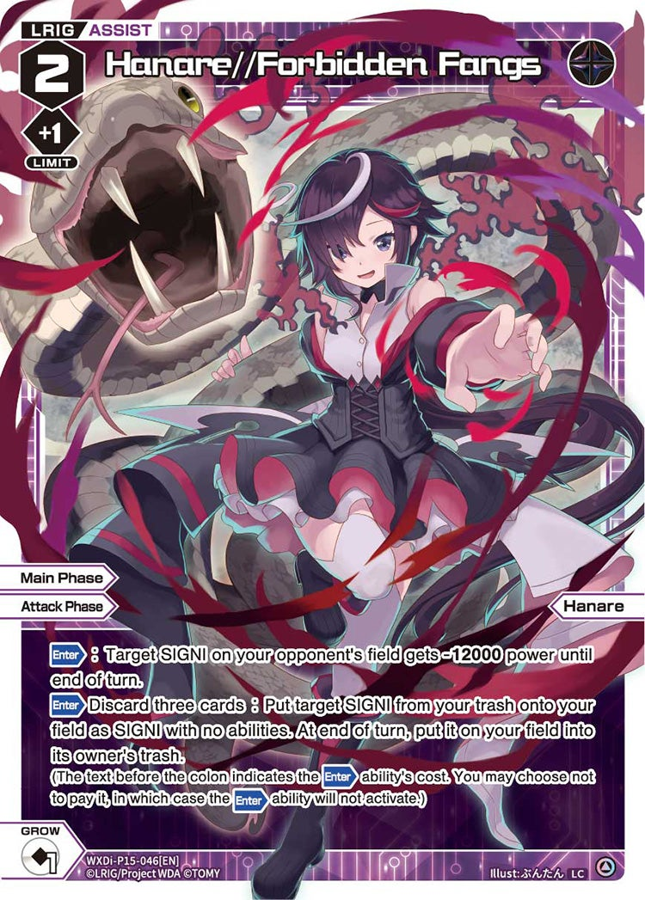

# Hanare//Forbidden Fangs

## Thông tin lá

| Trường | Giá trị |
| --- | --- |
| Mã in | WXDi-P15-046[EN] |
| Set | WXDi-P15[EN] |
| Số thứ tự | 046 |
| Loại thẻ | ASSIST LRIG |
| Vị trí | LRIG Deck |
| Số bản | — (set booster, không áp dụng) |
| Màu | Đen |
| Độ hiếm | LC,LC(P) |
| Minh họa | ぶんたん |
| Level | 2 |
| Limit | 1 |
| Power | 0 |
| LRIG type / Class | Hanare |
| Team / Master | — |
| Cost | — |
| Grow cost | 《C》×１ |
| Use timing | Main Phase
Attack Phase |
| Life Burst | Không |

## Card text chính thức

[Enter]: Target SIGNI on your opponent's field gets -12000 power until end of turn.
[Enter] Discard three cards: Put target SIGNI from your trash onto your field as SIGNI with no abilities. At end of turn, put it on your field into its owner's trash.
(The text before the colon indicates the [Enter] ability's cost. You may choose not to pay it, in which case the [Enter] ability will not activate.)

## Power text / Life Burst

—

## Ghi chú minh họa
Artist: ぶんたん. Ảnh LC được tải từ Card List tiếng Anh.

## FAQ chính thức

**Q. I put SIGNI that was put on the field by the second [Enter] ability return into my hand by another effect. What happens at the end of the turn?**
A. If the SIGNI is not on the field at the end of the turn, then nothing happens to the effect of putting it into its owner's trash.

## Ảnh biến thể

- [LC(P)](../images/WXDi-P15-046P-EN.jpg)

## Nguồn
[Card List/FAQ chính thức](https://www.takaratomy.co.jp/products/en.wixoss/card/card.html?card_no=WXDi-P15-046%5BEN%5D ) · [Ảnh thẻ](https://www.takaratomy.co.jp/products/en.wixoss/card/thumb/WXDi-P15-046%5BEN%5D.jpg)
