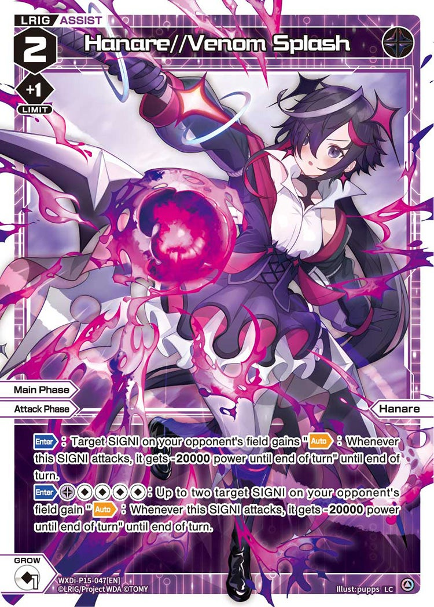

# Hanare//Venom Splash

## Thông tin lá

| Trường | Giá trị |
| --- | --- |
| Mã in | WXDi-P15-047[EN] |
| Set | WXDi-P15[EN] |
| Số thứ tự | 047 |
| Loại thẻ | ASSIST LRIG |
| Vị trí | LRIG Deck |
| Số bản | — (set booster, không áp dụng) |
| Màu | Đen |
| Độ hiếm | LC,LC(P) |
| Minh họa | pupps |
| Level | 2 |
| Limit | 1 |
| Power | 0 |
| LRIG type / Class | Hanare |
| Team / Master | — |
| Cost | — |
| Grow cost | 《C》×１ |
| Use timing | Main Phase / Attack Phase |
| Life Burst | Không |

## Card text chính thức

[Enter]: Target SIGNI on your opponent's field gains "[Auto]: Whenever this SIGNI attacks, it gets -20000 power until end of turn" until end of turn.
[Enter] {Black} {Colorless} {Colorless} {Colorless} {Colorless}: Up to two target SIGNI on your opponent's field gain "[Auto]: Whenever this SIGNI attacks, it gets -20000 power until end of turn" until end of turn.

## Power text / Life Burst

—

## Ghi chú minh họa
Artist: pupps. Ảnh LC được tải từ Card List tiếng Anh.

## FAQ chính thức

**Q. What happens if the SIGNI that is given the [Auto] ability by this [Enter] ability has the “whenever this SIGNI attacks” ability? Also, if it is attacked with no SIGNI in front of it, and its power is reduced to -20000 power and becomes 0 or less, may it deal damage?**
A. In that case, there are two [Auto] abilities that trigger “whenever this SIGNI attacks”, and the ability on the side of the attacking SIGNI who is the turn player triggers first. After that, this ability is triggered and its power is reduced to -20000 power. If the power becomes 0 or less, it is vanished by Rule-based action, and no battle with the front SIGNI or damage to your opponent will occur.

## Ảnh biến thể

- [LC(P)](../images/WXDi-P15-047P-EN.jpg)

## Nguồn
[Card List/FAQ chính thức](https://www.takaratomy.co.jp/products/en.wixoss/card/card.html?card_no=WXDi-P15-047%5BEN%5D ) · [Ảnh thẻ](https://www.takaratomy.co.jp/products/en.wixoss/card/thumb/WXDi-P15-047%5BEN%5D.jpg)
