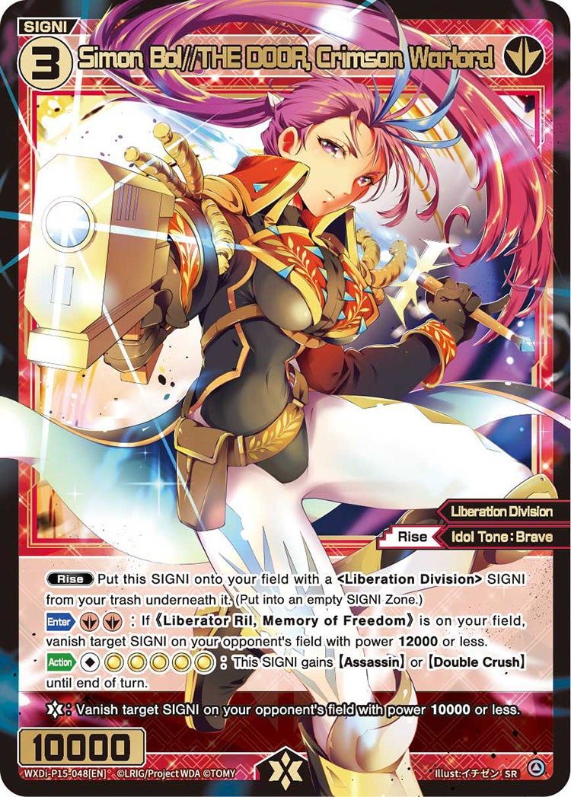

# Simon Bol//THE DOOR, Crimson Warlord

## Thông tin lá

| Trường | Giá trị |
| --- | --- |
| Mã in | WXDi-P15-048[EN] |
| Set | WXDi-P15[EN] |
| Số thứ tự | 048 |
| Loại thẻ | SIGNI |
| Vị trí | Main Deck |
| Số bản | — (set booster, không áp dụng) |
| Màu | Đỏ |
| Độ hiếm | SR,SRP |
| Minh họa | イチゼン |
| Level | 3 |
| Limit | — |
| Power | 10000 |
| LRIG type / Class | Liberation Division/Idol Tone：Brave |
| Team / Master | — |
| Cost | — |
| Grow cost | — |
| Use timing | — |
| Life Burst | Có |

## Card text chính thức

[Rise] Put this SIGNI onto your field with a <Liberation Division> SIGNI from your trash underneath it. (Put into an empty SIGNI Zone.)
[Enter] {Red} {Red}: If 《Liberator Ril, Memory of Freedom》 is on your field, vanish target SIGNI on your opponent's field with power 12000 or less.
[Action] {Colorless} {Coin Icon} {Coin Icon} {Coin Icon} {Coin Icon} {Coin Icon}: This SIGNI gains 【Assassin】 or 【Double Crush】 until end of turn.

## Power text / Life Burst

Vanish target SIGNI on your opponent's field with power 10000 or less.

## Ghi chú minh họa
Artist: イチゼン. Ảnh SR được tải từ Card List tiếng Anh.

## FAQ chính thức

**Q. What happens if a card is placed underneath a SIGNI and then the SIGNI leaves the field?**
A. Regardless of where the SIGNI moves from the field, any cards placed underneath the SIGNI are put into its owner's trash by Rule-based action.

## Ảnh biến thể

- [SRP](../images/WXDi-P15-048P-EN.jpg)

## Nguồn
[Card List/FAQ chính thức](https://www.takaratomy.co.jp/products/en.wixoss/card/card.html?card_no=WXDi-P15-048%5BEN%5D ) · [Ảnh thẻ](https://www.takaratomy.co.jp/products/en.wixoss/card/thumb/WXDi-P15-048%5BEN%5D.jpg)
