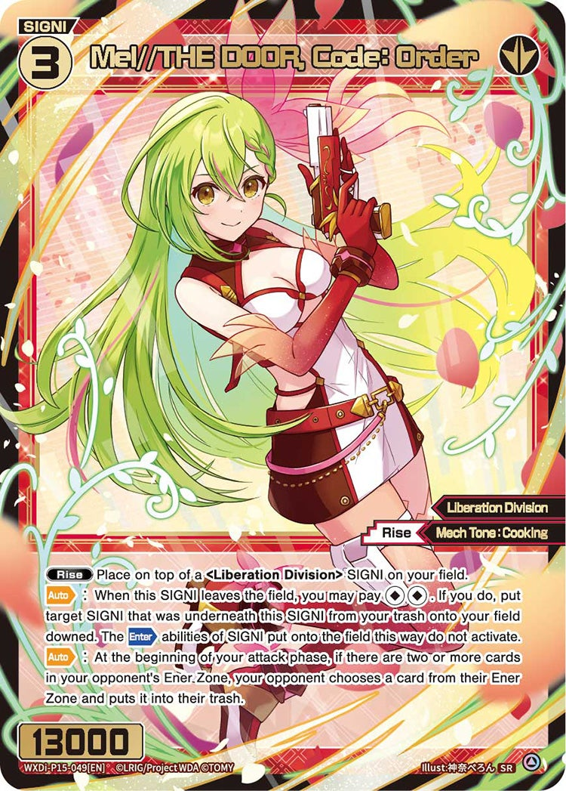

# Mel//THE DOOR, Code: Order

## Thông tin lá

| Trường | Giá trị |
| --- | --- |
| Mã in | WXDi-P15-049[EN] |
| Set | WXDi-P15[EN] |
| Số thứ tự | 049 |
| Loại thẻ | SIGNI |
| Vị trí | Main Deck |
| Số bản | — (set booster, không áp dụng) |
| Màu | Đỏ |
| Độ hiếm | SR,SRP |
| Minh họa | 神奈ぺろん |
| Level | 3 |
| Limit | — |
| Power | 13000 |
| LRIG type / Class | Liberation Division/Mech Tone：Cooking |
| Team / Master | — |
| Cost | — |
| Grow cost | — |
| Use timing | — |
| Life Burst | Không |

## Card text chính thức

[Rise] Place on top of a <Liberation Division> SIGNI on your field.
[Auto]: When this SIGNI leaves the field, you may pay {Colorless} {Colorless}. If you do, put target SIGNI that was underneath this SIGNI from your trash onto your field downed. The [Enter] abilities of SIGNI put onto the field this way do not activate.
[Auto]: At the beginning of your attack phase, if there are two or more cards in your opponent's Ener Zone, your opponent chooses a card from their Ener Zone and puts it into their trash.

## Power text / Life Burst

—

## Ghi chú minh họa
Artist: 神奈ぺろん. Ảnh SR được tải từ Card List tiếng Anh.

## FAQ chính thức

**Q. What happens if a card is placed underneath a SIGNI and then the SIGNI leaves the field?**
A. Regardless of where the SIGNI moves from the field, any cards placed underneath the SIGNI are put into its owner's trash by Rule-based action.
In the case of this SIGNI, the first [Auto] ability is then triggered and the SIGNI put into its owner's trash can be put on the field.

**Q. If there are two 《Mel//THE DOOR, Code: Order》 on the field and my opponent has two cards in their Ener zone, what happens at the beginning of the attack phase?**
A. Each of the second [Auto] abilities triggers and resolves, and since the first resolving put one card from your opponent's Ener zone into its owner's trash, when the second triggers, the condition is not met, and nothing happens when it resolves. As a result, in this case, put only one card into its owner's trash (your opponent's Ener zone will not be reduced to zero by these effect).

## Ảnh biến thể

- [SRP](../images/WXDi-P15-049P-EN.jpg)

## Nguồn
[Card List/FAQ chính thức](https://www.takaratomy.co.jp/products/en.wixoss/card/card.html?card_no=WXDi-P15-049%5BEN%5D ) · [Ảnh thẻ](https://www.takaratomy.co.jp/products/en.wixoss/card/thumb/WXDi-P15-049%5BEN%5D.jpg)
