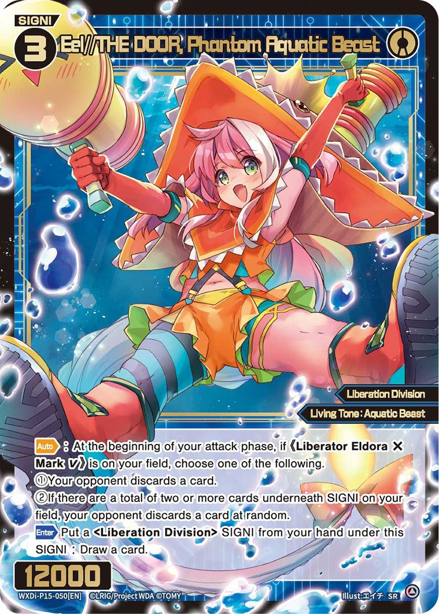

# Eel//THE DOOR, Phantom Aquatic Beast

## Thông tin lá

| Trường | Giá trị |
| --- | --- |
| Mã in | WXDi-P15-050[EN] |
| Set | WXDi-P15[EN] |
| Số thứ tự | 050 |
| Loại thẻ | SIGNI |
| Vị trí | Main Deck |
| Số bản | — (set booster, không áp dụng) |
| Màu | Xanh dương |
| Độ hiếm | SR,SRP |
| Minh họa | エイチ |
| Level | 3 |
| Limit | — |
| Power | 12000 |
| LRIG type / Class | Liberation Division/Living Tone：Aquatic Beast |
| Team / Master | — |
| Cost | — |
| Grow cost | — |
| Use timing | — |
| Life Burst | Không |

## Card text chính thức

[Auto]: At the beginning of your attack phase, if 《Liberator Eldora × Mark ν》 is on your field, choose one of the following.
①Your opponent discards a card.
②If there are a total of two or more cards underneath SIGNI on your field, your opponent discards a card at random.
[Enter] Put a <Liberation Division> SIGNI from your hand under this SIGNI: Draw a card.

## Power text / Life Burst

—

## Ghi chú minh họa
Artist: エイチ. Ảnh SR được tải từ Card List tiếng Anh.

## FAQ chính thức

**Q. If a card is placed underneath each of the two SIGNI in my field, does it meet the condition in (2)?**
A. Yes, it is met, whether there is one card underneath each of the two SIGNI or two cards underneath one SIGNI, both of which meet condition (2).

**Q. What happens if a card is placed underneath a SIGNI and then the SIGNI leaves the field?**
A. Regardless of where the SIGNI moves from the field, any cards placed underneath the SIGNI are put into its owner's trash by Rule-based action.

**Q. If I have a face-down SIGNI with underneath SIGNI by 《Digital Aya! III》, does that count as a “card that was underneath this SIGNI”?**
A. No, it does not count. “Card that was underneath this SIGNI” means cards placed underneath SIGNI by effects that place a card underneath SIGNI, such as the first [Action] ability this card, or cards placed underneath SIGNI by [Rise]. Also, “card that was underneath this SIGNI” is the one put into its owner's trash by Rule-based action when the SIGNI above leaves the field.

## Ảnh biến thể

- [SRP](../images/WXDi-P15-050P-EN.jpg)

## Nguồn
[Card List/FAQ chính thức](https://www.takaratomy.co.jp/products/en.wixoss/card/card.html?card_no=WXDi-P15-050%5BEN%5D ) · [Ảnh thẻ](https://www.takaratomy.co.jp/products/en.wixoss/card/thumb/WXDi-P15-050%5BEN%5D.jpg)
