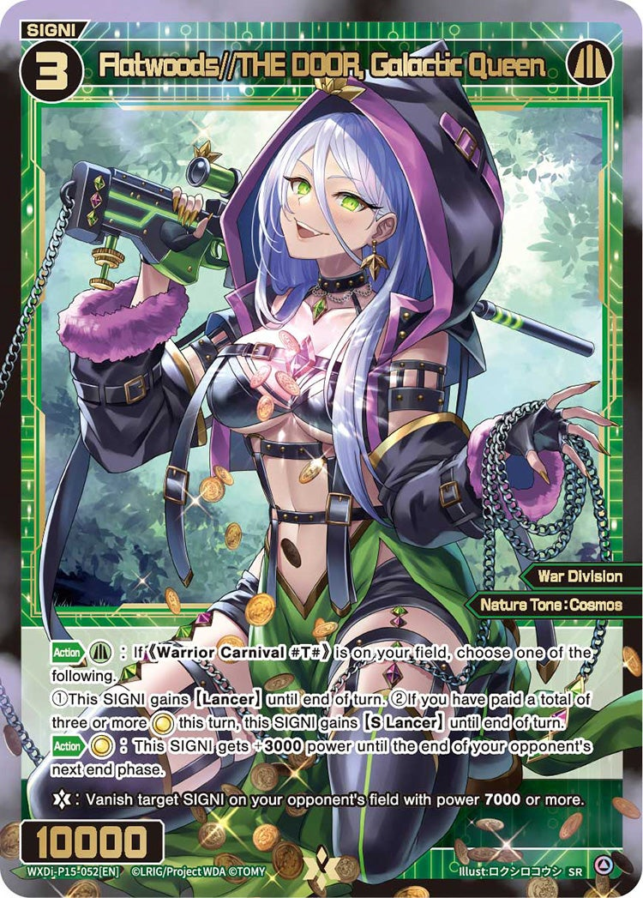

# Flatwoods//THE DOOR, Galactic Queen

## Thông tin lá

| Trường | Giá trị |
| --- | --- |
| Mã in | WXDi-P15-052[EN] |
| Set | WXDi-P15[EN] |
| Số thứ tự | 052 |
| Loại thẻ | SIGNI |
| Vị trí | Main Deck |
| Số bản | — (set booster, không áp dụng) |
| Màu | Xanh lá |
| Độ hiếm | SR,SRP |
| Minh họa | ロクシロコウシ |
| Level | 3 |
| Limit | — |
| Power | 10000 |
| LRIG type / Class | War Division/Nature Tone：Cosmos |
| Team / Master | — |
| Cost | — |
| Grow cost | — |
| Use timing | — |
| Life Burst | Có |

## Card text chính thức

[Action] {Green}: If 《Warrior Carnival #T#》 is on your field, choose one of the following.
①This SIGNI gains 【Lancer】 until end of turn. ②If you have paid a total of three or more {Coin Icon} this turn, this SIGNI gains 【S Lancer】 until end of turn.
[Action] {Coin Icon}: This SIGNI gets +3000 power until the end of your opponent's next end phase.

## Power text / Life Burst

Vanish target SIGNI on your opponent's field with power 7000 or more.

## Ghi chú minh họa
Artist: ロクシロコウシ. Ảnh SR được tải từ Card List tiếng Anh.

## FAQ chính thức

**Q. If I use a spell of Bet, does that count towards the number of coins I was paying?**
A. Yes, they can be counted.

**Q. What kind of ability does [S Lancer] have?**
A. When a SIGNI with [S Lancer] vanishes an opponent's SIGNI by battle, it crushes an opponent's Life Cloth, and if the opponent has no Life Cloth, it deals damage to the opponent. Even if a SIGNI has more than one [Lancer] or [S Lancer], it can only be triggered once in one battle.

## Ảnh biến thể

- [SRP](../images/WXDi-P15-052P-EN.jpg)

## Nguồn
[Card List/FAQ chính thức](https://www.takaratomy.co.jp/products/en.wixoss/card/card.html?card_no=WXDi-P15-052%5BEN%5D ) · [Ảnh thẻ](https://www.takaratomy.co.jp/products/en.wixoss/card/thumb/WXDi-P15-052%5BEN%5D.jpg)
