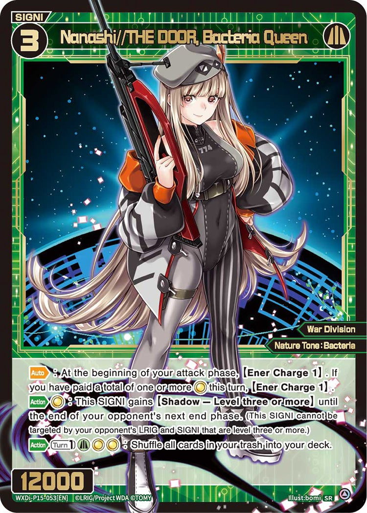

# Nanashi//THE DOOR, Bacteria Queen

## Thông tin lá

| Trường | Giá trị |
| --- | --- |
| Mã in | WXDi-P15-053[EN] |
| Set | WXDi-P15[EN] |
| Số thứ tự | 053 |
| Loại thẻ | SIGNI |
| Vị trí | Main Deck |
| Số bản | — (set booster, không áp dụng) |
| Màu | Xanh lá |
| Độ hiếm | SR,SRP |
| Minh họa | bomi |
| Level | 3 |
| Limit | — |
| Power | 12000 |
| LRIG type / Class | War Division/Nature Tone：Bacteria |
| Team / Master | — |
| Cost | — |
| Grow cost | — |
| Use timing | — |
| Life Burst | Không |

## Card text chính thức

[Auto]: At the beginning of your attack phase, 【Ener Charge 1】. If you have paid a total of one or more {Coin Icon} this turn, 【Ener Charge 1】.
[Action] {Coin Icon}: This SIGNI gains 【Shadow — Level three or more】 until the end of your opponent's next end phase. (This SIGNI cannot be targeted by your opponent's LRIG and SIGNI that are level three or more.)
[Action] {1/Turn} {Green} {Coin Icon} {Coin Icon}: Shuffle all cards in your trash into your deck.

## Power text / Life Burst

—

## Ghi chú minh họa
Artist: bomi. Ảnh SR được tải từ Card List tiếng Anh.

## FAQ chính thức

**Q. If I use a spell of Bet, does that count towards the number of coins I was paying?**
A. Yes, they can be counted.

**Q. If this card gains 【Shadow - (Level three or more SIGNI)】, may this card targeted by the Life Burst effect of a level three or higher SIGNI?**
A. No. If it is a card of a level three or higher SIGNI, even if it is a Life Burst, it is not target by the effect.

## Ảnh biến thể

- [SRP](../images/WXDi-P15-053P-EN.jpg)

## Nguồn
[Card List/FAQ chính thức](https://www.takaratomy.co.jp/products/en.wixoss/card/card.html?card_no=WXDi-P15-053%5BEN%5D ) · [Ảnh thẻ](https://www.takaratomy.co.jp/products/en.wixoss/card/thumb/WXDi-P15-053%5BEN%5D.jpg)
