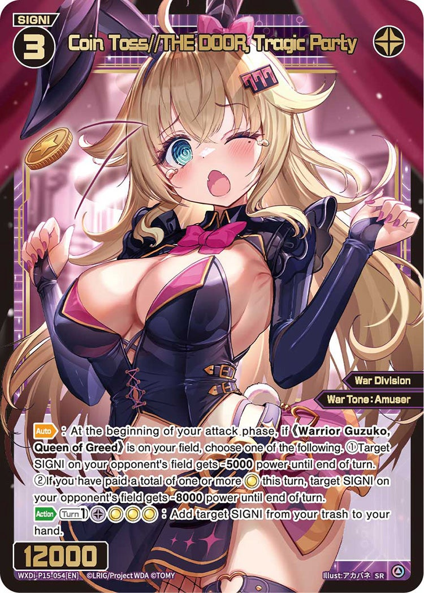

# Coin Toss//THE DOOR, Tragic Party

## Thông tin lá

| Trường | Giá trị |
| --- | --- |
| Mã in | WXDi-P15-054[EN] |
| Set | WXDi-P15[EN] |
| Số thứ tự | 054 |
| Loại thẻ | SIGNI |
| Vị trí | Main Deck |
| Số bản | — (set booster, không áp dụng) |
| Màu | Đen |
| Độ hiếm | SR,SRP |
| Minh họa | アカバネ |
| Level | 3 |
| Limit | — |
| Power | 12000 |
| LRIG type / Class | War Division/War Tone：Amuser |
| Team / Master | — |
| Cost | — |
| Grow cost | — |
| Use timing | — |
| Life Burst | Không |

## Card text chính thức

[Auto]: At the beginning of your attack phase, if 《Warrior Guzuko, Queen of Greed》 is on your field, choose one of the following. ①Target SIGNI on your opponent's field gets -5000 power until end of turn. ②If you have paid a total of one or more {Coin Icon} this turn, target SIGNI on your opponent's field gets -8000 power until end of turn.
[Action] {1/Turn} {Black} {Coin Icon} {Coin Icon} {Coin Icon}: Add target SIGNI from your trash to your hand.

## Power text / Life Burst

—

## Ghi chú minh họa
Artist: アカバネ. Ảnh SR được tải từ Card List tiếng Anh.

## FAQ chính thức

**Q. If I use a spell of Bet, does that count towards the number of coins I was paying?**
A. Yes, they can be counted.

**Q. May I add it to my hand by this effect when the card paid for {black} cost of the [Action] ability?**
A. Yes, you can.

## Ảnh biến thể

- [SRP](../images/WXDi-P15-054P-EN.jpg)

## Nguồn
[Card List/FAQ chính thức](https://www.takaratomy.co.jp/products/en.wixoss/card/card.html?card_no=WXDi-P15-054%5BEN%5D ) · [Ảnh thẻ](https://www.takaratomy.co.jp/products/en.wixoss/card/thumb/WXDi-P15-054%5BEN%5D.jpg)
