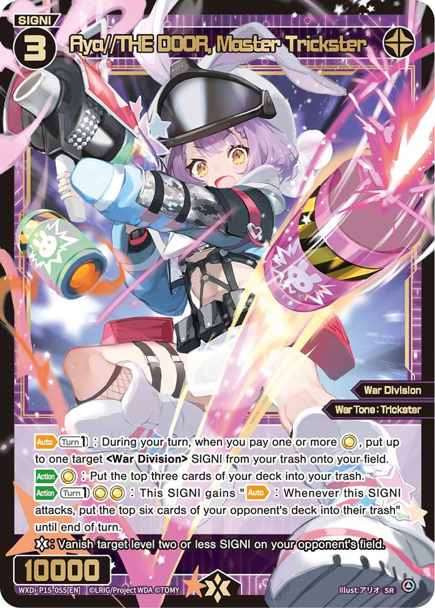

# Aya//THE DOOR, Master Trickster

## Thông tin lá

| Trường | Giá trị |
| --- | --- |
| Mã in | WXDi-P15-055[EN] |
| Set | WXDi-P15[EN] |
| Số thứ tự | 055 |
| Loại thẻ | SIGNI |
| Vị trí | Main Deck |
| Số bản | — (set booster, không áp dụng) |
| Màu | Đen |
| Độ hiếm | SR,SRP |
| Minh họa | アリオ |
| Level | 3 |
| Limit | — |
| Power | 10000 |
| LRIG type / Class | War Division/War Tone：Trickster |
| Team / Master | — |
| Cost | — |
| Grow cost | — |
| Use timing | — |
| Life Burst | Có |

## Card text chính thức

[Auto] {1/Turn}: During your turn, when you pay one or more {Coin Icon}, put up to one target <War Division> SIGNI from your trash onto your field.
[Action] {Coin Icon}: Put the top three cards of your deck into your trash.
[Action] {1/Turn} {Coin Icon} {Coin Icon}: This SIGNI gains "[Auto]: Whenever this SIGNI attacks, put the top six cards of your opponent's deck into their trash" until end of turn.

## Power text / Life Burst

Vanish target level two or less SIGNI on your opponent's field.

## Ghi chú minh họa
Artist: アリオ. Ảnh SR được tải từ Card List tiếng Anh.

## FAQ chính thức

**Q. When I pay coins by this SIGNI's [Action] ability, does it also trigger the [Auto] ability?**
A. Yes, it will trigger. The [Auto] ability is triggered after the [Action] ability is resolved.

**Q. If I use a spell of Bet, does the [Auto] ability trigger?**
A. Yes, it will trigger. The [Auto] ability is triggered after the processing of that spell used by betting is finished.

## Ảnh biến thể

- [SRP](../images/WXDi-P15-055P-EN.jpg)

## Nguồn
[Card List/FAQ chính thức](https://www.takaratomy.co.jp/products/en.wixoss/card/card.html?card_no=WXDi-P15-055%5BEN%5D ) · [Ảnh thẻ](https://www.takaratomy.co.jp/products/en.wixoss/card/thumb/WXDi-P15-055%5BEN%5D.jpg)
