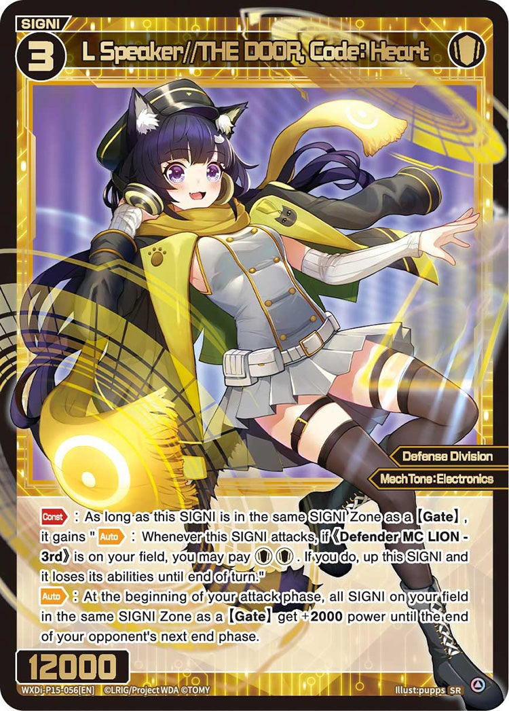

# L Speaker//THE DOOR, Code: Heart

## Thông tin lá

| Trường | Giá trị |
| --- | --- |
| Mã in | WXDi-P15-056[EN] |
| Set | WXDi-P15[EN] |
| Số thứ tự | 056 |
| Loại thẻ | SIGNI |
| Vị trí | Main Deck |
| Số bản | — (set booster, không áp dụng) |
| Màu | Trắng |
| Độ hiếm | SR,SRP |
| Minh họa | pupps |
| Level | 3 |
| Limit | — |
| Power | 12000 |
| LRIG type / Class | Defense Division/Mech Tone：Electronics |
| Team / Master | — |
| Cost | — |
| Grow cost | — |
| Use timing | — |
| Life Burst | Không |

## Card text chính thức

[Constant]: As long as this SIGNI is in the same SIGNI Zone as a 【Gate】, it gains "[Auto]: Whenever this SIGNI attacks, if 《Defender MC LION - 3rd》 is on your field, you may pay {White} {White}. If you do, up this SIGNI and it loses its abilities until end of turn."
[Auto]: At the beginning of your attack phase, all SIGNI on your field in the same SIGNI Zone as a 【Gate】 get +2000 power until the end of your opponent's next end phase.

## Power text / Life Burst

—

## Ghi chú minh họa
Artist: pupps. Ảnh SR được tải từ Card List tiếng Anh.

## FAQ chính thức

**Q. What is [Gate]?**
A. You may put [Gate] in a SIGNI Zone due to the effect of this card. You may put up to one [Gate] per SIGNI Zone. However, the presence or absence of a [Gate] may change the effect of some cards.

**Q. After the second [Auto] ability is resolved, if I put SIGNI into the SIGNI zone with [Gate] or put new [Gate] in the SIGNI zone with SIGNI, does the power of those SIGNI get +2000 power?**
A. No, it does not. This effect only affects SIGNI in the SIGNI zone with [Gate] at the time the [Auto] ability is resolved. Power will not be increased if SIGNI put into the field later or if [Gate] put in SIGNI zone later.

## Ảnh biến thể

- [SRP](../images/WXDi-P15-056P-EN.jpg)

## Nguồn
[Card List/FAQ chính thức](https://www.takaratomy.co.jp/products/en.wixoss/card/card.html?card_no=WXDi-P15-056%5BEN%5D ) · [Ảnh thẻ](https://www.takaratomy.co.jp/products/en.wixoss/card/thumb/WXDi-P15-056%5BEN%5D.jpg)
