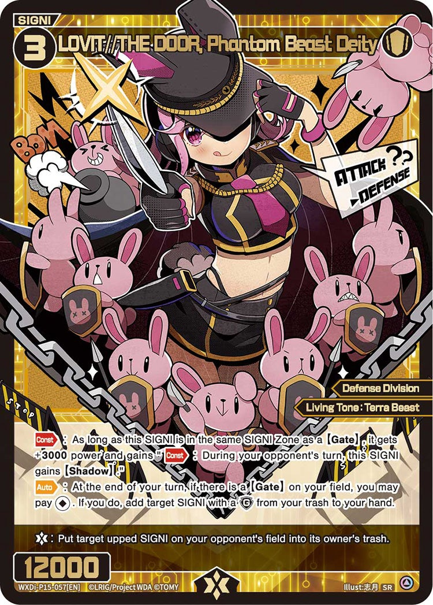

# LOVIT//THE DOOR, Phantom Beast Deity

## Thông tin lá

| Trường | Giá trị |
| --- | --- |
| Mã in | WXDi-P15-057[EN] |
| Set | WXDi-P15[EN] |
| Số thứ tự | 057 |
| Loại thẻ | SIGNI |
| Vị trí | Main Deck |
| Số bản | — (set booster, không áp dụng) |
| Màu | Trắng |
| Độ hiếm | SR,SRP |
| Minh họa | 志月 |
| Level | 3 |
| Limit | — |
| Power | 12000 |
| LRIG type / Class | Defense Division/Living Tone：Terra Beast |
| Team / Master | — |
| Cost | — |
| Grow cost | — |
| Use timing | — |
| Life Burst | Có |

## Card text chính thức

[Constant]: As long as this SIGNI is in the same SIGNI Zone as a 【Gate】, it gets +3000 power and gains "[Constant]: During your opponent's turn, this SIGNI gains 【Shadow】."
[Auto]: At the end of your turn, if there is a 【Gate】 on your field, you may pay {Colorless}. If you do, add target SIGNI with a {Guard Icon} from your trash to your hand.

## Power text / Life Burst

Put target upped SIGNI on your opponent's field into its owner's trash.

## Ghi chú minh họa
Artist: 志月. Ảnh SR được tải từ Card List tiếng Anh.

## FAQ chính thức

**Q. What is [Gate]?**
A. You may put [Gate] in a SIGNI Zone due to the effect of this card. You may put up to one [Gate] per SIGNI Zone. However, the presence or absence of a [Gate] may change the effect of some cards.

## Ảnh biến thể

- [SRP](../images/WXDi-P15-057P-EN.jpg)

## Nguồn
[Card List/FAQ chính thức](https://www.takaratomy.co.jp/products/en.wixoss/card/card.html?card_no=WXDi-P15-057%5BEN%5D ) · [Ảnh thẻ](https://www.takaratomy.co.jp/products/en.wixoss/card/thumb/WXDi-P15-057%5BEN%5D.jpg)
