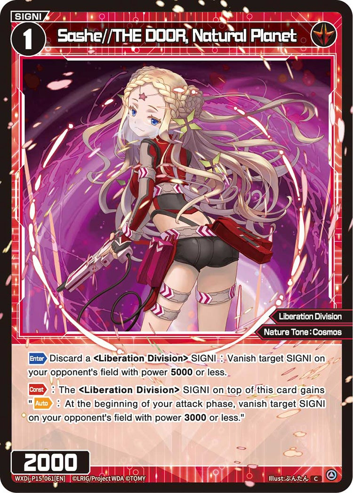

# Sashe//THE DOOR, Natural Planet

## Thông tin lá

| Trường | Giá trị |
| --- | --- |
| Mã in | WXDi-P15-061[EN] |
| Set | WXDi-P15[EN] |
| Số thứ tự | 061 |
| Loại thẻ | SIGNI |
| Vị trí | Main Deck |
| Số bản | — (set booster, không áp dụng) |
| Màu | Đỏ |
| Độ hiếm | C,C(P) |
| Minh họa | ぶんたん |
| Level | 1 |
| Limit | — |
| Power | 2000 |
| LRIG type / Class | Liberation Division/Nature Tone：Cosmos |
| Team / Master | — |
| Cost | — |
| Grow cost | — |
| Use timing | — |
| Life Burst | Không |

## Card text chính thức

[Enter] Discard a <Liberation Division> SIGNI: Vanish target SIGNI on your opponent's field with power 5000 or less.

[Constant]: The <Liberation Division> SIGNI on top of this card gains "[Auto]: At the beginning of your attack phase, vanish target SIGNI on your opponent's field with power 3000 or less."

## Power text / Life Burst

—

## Ghi chú minh họa
Artist: ぶんたん. Ảnh C được tải từ Card List tiếng Anh.

## FAQ chính thức

**Q. If there are two copies of 《Sashe//THE DOOR, Natural Planet》 placed underneath a <Liberation Division> SIGNI, does that <Liberation Division> SIGNI gain two [Auto] abilities?**
A. Yes, your SIGNI gain abilities from each of the two 《Sashe//THE DOOR, Natural Planet》 and both are triggered at the beginning of the attack phase.

## Ảnh biến thể

- [C(P)](../images/WXDi-P15-061P-EN.jpg)

## Nguồn
[Card List/FAQ chính thức](https://www.takaratomy.co.jp/products/en.wixoss/card/card.html?card_no=WXDi-P15-061%5BEN%5D ) · [Ảnh thẻ](https://www.takaratomy.co.jp/products/en.wixoss/card/thumb/WXDi-P15-061%5BEN%5D.jpg)
