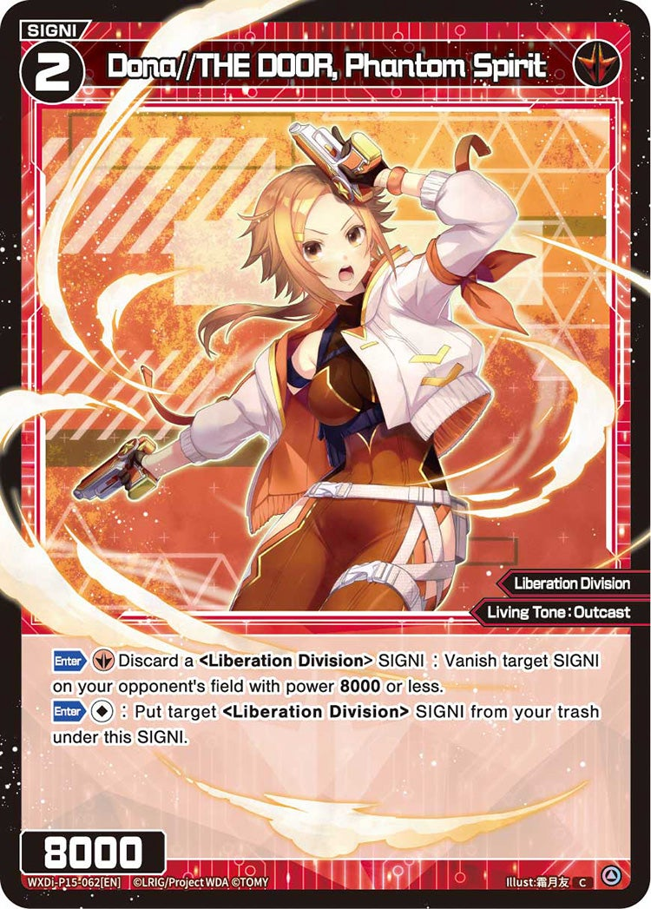

# Dona//THE DOOR, Phantom Spirit

## Thông tin lá

| Trường | Giá trị |
| --- | --- |
| Mã in | WXDi-P15-062[EN] |
| Set | WXDi-P15[EN] |
| Số thứ tự | 062 |
| Loại thẻ | SIGNI |
| Vị trí | Main Deck |
| Số bản | — (set booster, không áp dụng) |
| Màu | Đỏ |
| Độ hiếm | C,C(P) |
| Minh họa | 霜月友 |
| Level | 2 |
| Limit | — |
| Power | 8000 |
| LRIG type / Class | Liberation Division/Living Tone：Outcast |
| Team / Master | — |
| Cost | — |
| Grow cost | — |
| Use timing | — |
| Life Burst | Không |

## Card text chính thức

[Enter] {Red} Discard a <Liberation Division> SIGNI: Vanish target SIGNI on your opponent's field with power 8000 or less.
[Enter] {Colorless}: Put target <Liberation Division> SIGNI from your trash under this SIGNI.

## Power text / Life Burst

—

## Ghi chú minh họa
Artist: 霜月友. Ảnh C được tải từ Card List tiếng Anh.

## FAQ chính thức

**Q. What happens if a card is placed underneath a SIGNI and then the SIGNI leaves the field?**
A. Regardless of where the SIGNI moves from the field, any cards placed underneath the SIGNI are put into its owner's trash by Rule-based action.

## Ảnh biến thể

- [C(P)](../images/WXDi-P15-062P-EN.jpg)

## Nguồn
[Card List/FAQ chính thức](https://www.takaratomy.co.jp/products/en.wixoss/card/card.html?card_no=WXDi-P15-062%5BEN%5D ) · [Ảnh thẻ](https://www.takaratomy.co.jp/products/en.wixoss/card/thumb/WXDi-P15-062%5BEN%5D.jpg)
