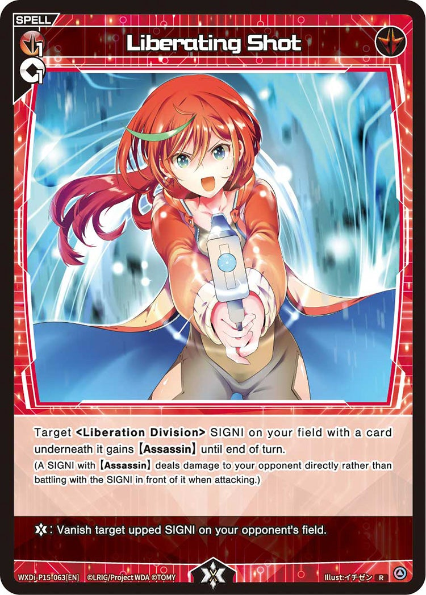

# Liberating Shot

## Thông tin lá

| Trường | Giá trị |
| --- | --- |
| Mã in | WXDi-P15-063[EN] |
| Set | WXDi-P15[EN] |
| Số thứ tự | 063 |
| Loại thẻ | SPELL |
| Vị trí | Main Deck |
| Số bản | — (set booster, không áp dụng) |
| Màu | Đỏ |
| Độ hiếm | R,R(P) |
| Minh họa | イチゼン |
| Level | — |
| Limit | — |
| Power | 0 |
| LRIG type / Class | — |
| Team / Master | — |
| Cost | 《R》×１ / 《C》×１ |
| Grow cost | — |
| Use timing | — |
| Life Burst | Có |

## Card text chính thức

Target <Liberation Division> SIGNI on your field with a card underneath it gains 【Assassin】 until end of turn.
(A SIGNI with 【Assassin】 deals damage to your opponent directly rather than battling with the SIGNI in front of it when attacking.)

## Power text / Life Burst

Vanish target upped SIGNI on your opponent's field.

## Ghi chú minh họa
Artist: イチゼン. Ảnh R được tải từ Card List tiếng Anh.

## FAQ chính thức

**Q. If a card is removed from underneath the SIGNI after this effect causes the SIGNI to gain [Assassin], does the SIGNI lose [Assassin]?**
A. No, it does not lose [Assassin]. Only check if there is a card underneath when you use this spell.

**Q. If I have a face-down SIGNI with underneath SIGNI by 《Digital Aya! III》, does that count as a “card that was underneath this SIGNI”?**
A. No, it does not count. “Card that was underneath this SIGNI” means cards placed underneath SIGNI by effects that place a card underneath SIGNI, such as the first [Action] ability this card, or cards placed underneath SIGNI by [Rise]. Also, “card that was underneath this SIGNI” is the one put into its owner's trash by Rule-based action when the SIGNI above leaves the field.

## Ảnh biến thể

- [R(P)](../images/WXDi-P15-063P-EN.jpg)

## Nguồn
[Card List/FAQ chính thức](https://www.takaratomy.co.jp/products/en.wixoss/card/card.html?card_no=WXDi-P15-063%5BEN%5D ) · [Ảnh thẻ](https://www.takaratomy.co.jp/products/en.wixoss/card/thumb/WXDi-P15-063%5BEN%5D.jpg)
