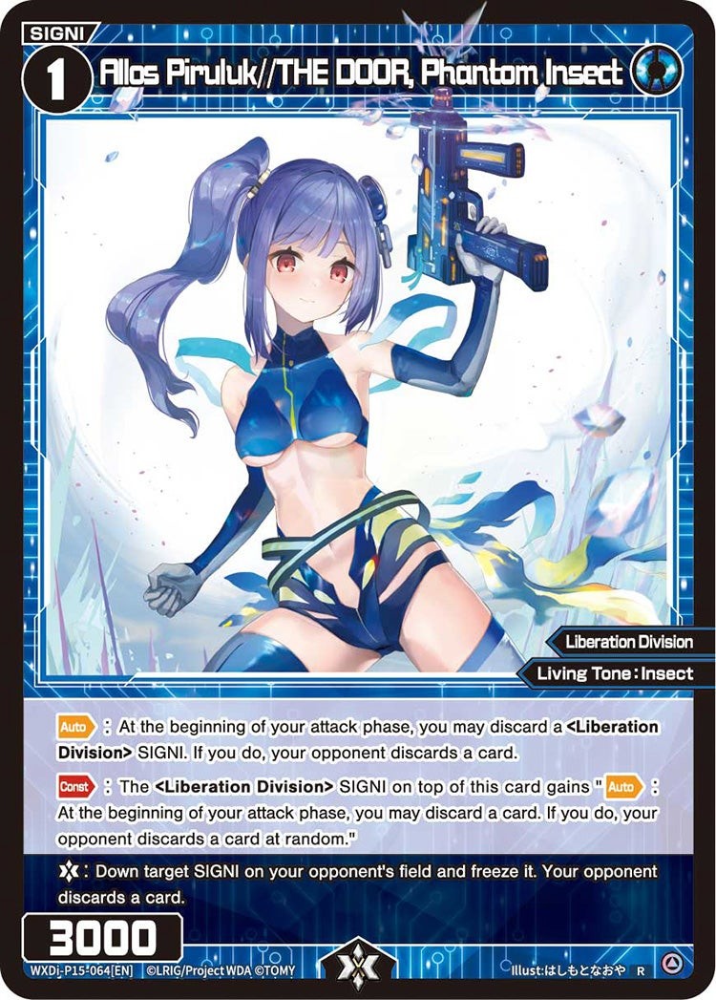

# Allos Piruluk//THE DOOR, Phantom Insect

## Thông tin lá

| Trường | Giá trị |
| --- | --- |
| Mã in | WXDi-P15-064[EN] |
| Set | WXDi-P15[EN] |
| Số thứ tự | 064 |
| Loại thẻ | SIGNI |
| Vị trí | Main Deck |
| Số bản | — (set booster, không áp dụng) |
| Màu | Xanh dương |
| Độ hiếm | R,R(P) |
| Minh họa | はしもとなおや |
| Level | 1 |
| Limit | — |
| Power | 3000 |
| LRIG type / Class | Liberation Division/Living Tone：Insect |
| Team / Master | — |
| Cost | — |
| Grow cost | — |
| Use timing | — |
| Life Burst | Có |

## Card text chính thức

[Auto]: At the beginning of your attack phase, you may discard a <Liberation Division> SIGNI. If you do, your opponent discards a card.

[Constant]: The <Liberation Division> SIGNI on top of this card gains "[Auto]: At the beginning of your attack phase, you may discard a card. If you do, your opponent discards a card at random."

## Power text / Life Burst

Down target SIGNI on your opponent's field and freeze it. Your opponent discards a card.

## Ghi chú minh họa
Artist: はしもとなおや. Ảnh R được tải từ Card List tiếng Anh.

## FAQ chính thức

**Q. If 《Allos Piruluk//THE DOOR, Phantom Insect》 is placed underneath SIGNI, does the first [Auto] ability of 《Allos Piruluk//THE DOOR, Phantom Insect》 trigger?**
A. No, it does not trigger.

**Q. If there are two copies of 《Allos Piruluk//THE DOOR, Phantom Insect》 placed underneath a <Liberation Division> SIGNI, does that <Liberation Division> SIGNI gain two [Auto] abilities?**
A. Yes, your SIGNI gain abilities from each of the two 《Allos Piruluk//THE DOOR, Phantom Insect》 and both are triggered at the beginning of the attack phase.

## Ảnh biến thể

- [R(P)](../images/WXDi-P15-064P-EN.jpg)

## Nguồn
[Card List/FAQ chính thức](https://www.takaratomy.co.jp/products/en.wixoss/card/card.html?card_no=WXDi-P15-064%5BEN%5D ) · [Ảnh thẻ](https://www.takaratomy.co.jp/products/en.wixoss/card/thumb/WXDi-P15-064%5BEN%5D.jpg)
