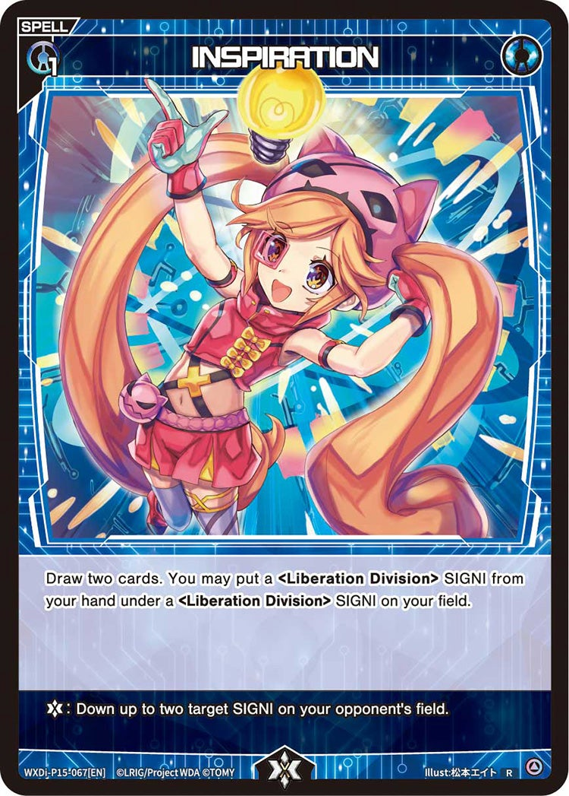

# INSPIRATION

## Thông tin lá

| Trường | Giá trị |
| --- | --- |
| Mã in | WXDi-P15-067[EN] |
| Set | WXDi-P15[EN] |
| Số thứ tự | 067 |
| Loại thẻ | SPELL |
| Vị trí | Main Deck |
| Số bản | — (set booster, không áp dụng) |
| Màu | Xanh dương |
| Độ hiếm | R,R(P) |
| Minh họa | 松本エイト |
| Level | — |
| Limit | — |
| Power | 0 |
| LRIG type / Class | — |
| Team / Master | — |
| Cost | 《U》×１ |
| Grow cost | — |
| Use timing | — |
| Life Burst | Có |

## Card text chính thức

Draw two cards. You may put a <Liberation Division> SIGNI from your hand under a <Liberation Division> SIGNI on your field.

## Power text / Life Burst

Down up to two target SIGNI on your opponent's field.

## Ghi chú minh họa
Artist: 松本エイト. Ảnh R được tải từ Card List tiếng Anh.

## FAQ chính thức

**Q. What happens if a card is placed underneath a SIGNI and then the SIGNI leaves the field?**
A. Regardless of where the SIGNI moves from the field, any cards placed underneath the SIGNI are put into its owner's trash by Rule-based action.

## Ảnh biến thể

- [R(P)](../images/WXDi-P15-067P-EN.jpg)

## Nguồn
[Card List/FAQ chính thức](https://www.takaratomy.co.jp/products/en.wixoss/card/card.html?card_no=WXDi-P15-067%5BEN%5D ) · [Ảnh thẻ](https://www.takaratomy.co.jp/products/en.wixoss/card/thumb/WXDi-P15-067%5BEN%5D.jpg)
