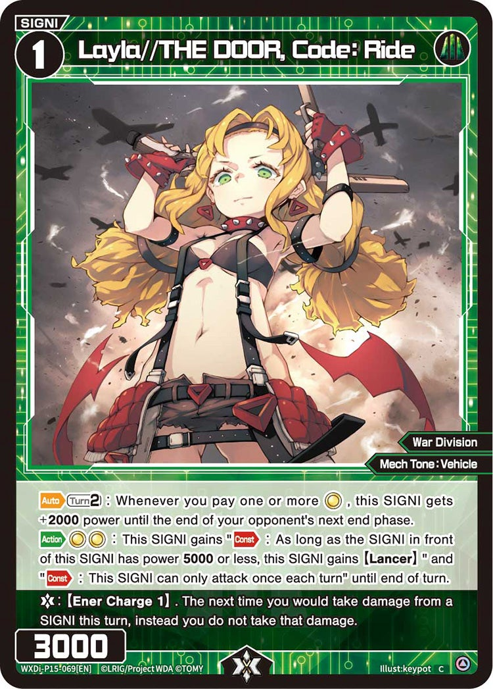

# Layla//THE DOOR, Code: Ride

## Thông tin lá

| Trường | Giá trị |
| --- | --- |
| Mã in | WXDi-P15-069[EN] |
| Set | WXDi-P15[EN] |
| Số thứ tự | 069 |
| Loại thẻ | SIGNI |
| Vị trí | Main Deck |
| Số bản | — (set booster, không áp dụng) |
| Màu | Xanh lá |
| Độ hiếm | C,C(P) |
| Minh họa | keypot |
| Level | 1 |
| Limit | — |
| Power | 3000 |
| LRIG type / Class | War Division/Mech Tone：Vehicle |
| Team / Master | — |
| Cost | — |
| Grow cost | — |
| Use timing | — |
| Life Burst | Có |

## Card text chính thức

[Auto] {2/Turn}: Whenever you pay one or more {Coin Icon}, this SIGNI gets +2000 power until the end of your opponent's next end phase.
[Action] {Coin Icon} {Coin Icon}: This SIGNI gains "[Constant]: As long as the SIGNI in front of this SIGNI has power 5000 or less, this SIGNI gains 【Lancer】" and "[Constant]: This SIGNI can only attack once each turn" until end of turn.

## Power text / Life Burst

【Ener Charge 1】. The next time you would take damage from a SIGNI this turn, instead you do not take that damage.

## Ghi chú minh họa
Artist: keypot. Ảnh C được tải từ Card List tiếng Anh.

## FAQ chính thức

**Q. If I pay two coins by the [Action] ability, does the [Auto] ability trigger twice?**
A. No. Even if you paid two coins in one payment, it will only trigger once “when you pay one or more {coin} ”.

## Ảnh biến thể

- [C(P)](../images/WXDi-P15-069P-EN.jpg)

## Nguồn
[Card List/FAQ chính thức](https://www.takaratomy.co.jp/products/en.wixoss/card/card.html?card_no=WXDi-P15-069%5BEN%5D ) · [Ảnh thẻ](https://www.takaratomy.co.jp/products/en.wixoss/card/thumb/WXDi-P15-069%5BEN%5D.jpg)
