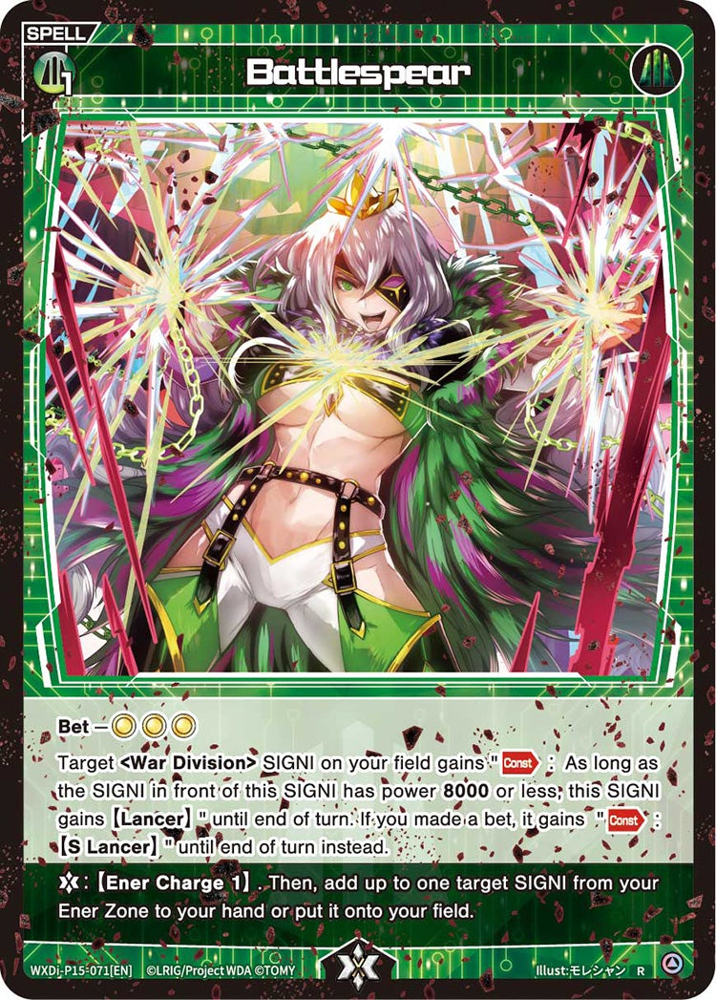

# Battlespear

## Thông tin lá

| Trường | Giá trị |
| --- | --- |
| Mã in | WXDi-P15-071[EN] |
| Set | WXDi-P15[EN] |
| Số thứ tự | 071 |
| Loại thẻ | SPELL |
| Vị trí | Main Deck |
| Số bản | — (set booster, không áp dụng) |
| Màu | Xanh lá |
| Độ hiếm | R,R(P) |
| Minh họa | モレシャン |
| Level | — |
| Limit | — |
| Power | 0 |
| LRIG type / Class | — |
| Team / Master | — |
| Cost | 《G》×１ |
| Grow cost | — |
| Use timing | — |
| Life Burst | Có |

## Card text chính thức

Bet — {Coin Icon} {Coin Icon} {Coin Icon}

Target <War Division> SIGNI on your field gains "[Constant]: As long as the SIGNI in front of this SIGNI has power 8000 or less, this SIGNI gains 【Lancer】" until end of turn. If you made a bet, it gains "[Constant]: 【S Lancer】" until end of turn instead.

## Power text / Life Burst

【Ener Charge 1】. Then, add up to one target SIGNI from your Ener Zone to your hand or put it onto your field.

## Ghi chú minh họa
Artist: モレシャン. Ảnh R được tải từ Card List tiếng Anh.

## FAQ chính thức

**Q. What kind of ability does [S Lancer] have?**
A. When a SIGNI with [S Lancer] vanishes an opponent's SIGNI by battle, it crushes an opponent's Life Cloth, and if the opponent has no Life Cloth, it deals damage to the opponent. Even if a SIGNI has more than one [Lancer] or [S Lancer], it can only be triggered once in one battle.

**Q. If I bet and use this spell, does my SIGNI gain [S Lancer] regardless of the power of the SIGNI in front of my SIGNI?**
A. Yes, if you have bet, your SIGNI gains [S Lancer].

## Ảnh biến thể

- [R(P)](../images/WXDi-P15-071P-EN.jpg)

## Nguồn
[Card List/FAQ chính thức](https://www.takaratomy.co.jp/products/en.wixoss/card/card.html?card_no=WXDi-P15-071%5BEN%5D ) · [Ảnh thẻ](https://www.takaratomy.co.jp/products/en.wixoss/card/thumb/WXDi-P15-071%5BEN%5D.jpg)
