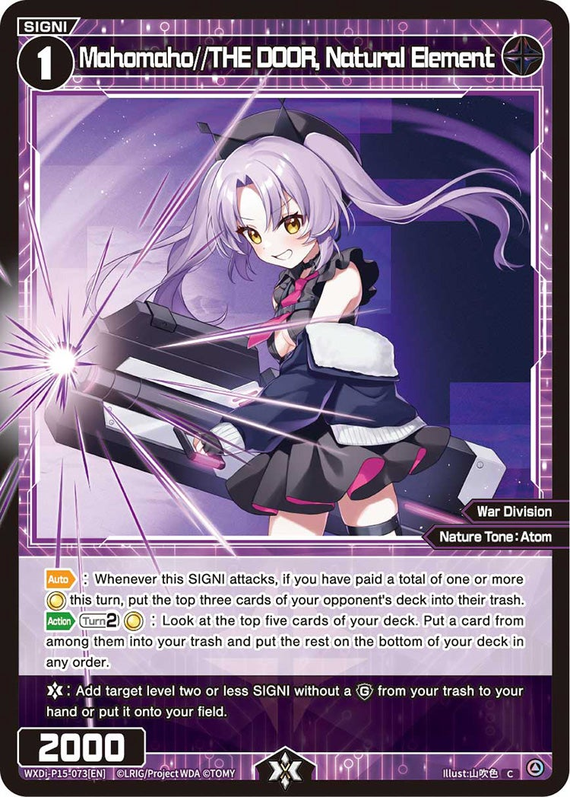

# Mahomaho//THE DOOR, Natural Element

## Thông tin lá

| Trường | Giá trị |
| --- | --- |
| Mã in | WXDi-P15-073[EN] |
| Set | WXDi-P15[EN] |
| Số thứ tự | 073 |
| Loại thẻ | SIGNI |
| Vị trí | Main Deck |
| Số bản | — (set booster, không áp dụng) |
| Màu | Đen |
| Độ hiếm | C,C(P) |
| Minh họa | 山吹色 |
| Level | 1 |
| Limit | — |
| Power | 2000 |
| LRIG type / Class | War Division/Nature Tone：Atom |
| Team / Master | — |
| Cost | — |
| Grow cost | — |
| Use timing | — |
| Life Burst | Có |

## Card text chính thức

[Auto]: Whenever this SIGNI attacks, if you have paid a total of one or more {Coin Icon} this turn, put the top three cards of your opponent's deck into their trash.
[Action] {2/Turn} {Coin Icon}: Look at the top five cards of your deck. Put a card from among them into your trash and put the rest on the bottom of your deck in any order.

## Power text / Life Burst

Add target level two or less SIGNI without a {Guard Icon} from your trash to your hand or put it onto your field.

## Ghi chú minh họa
Artist: 山吹色. Ảnh C được tải từ Card List tiếng Anh.

## FAQ chính thức

**Q. What happens if I use the [Action] ability when there is only one card left in my deck?**
A. In that case, you look at that one card and it must be put into its owner's trash (you cannot choose to return it to its owner's deck). After that, the effect ends and the deck is zero cards, so refresh is performed.

## Ảnh biến thể

- [C(P)](../images/WXDi-P15-073P-EN.jpg)

## Nguồn
[Card List/FAQ chính thức](https://www.takaratomy.co.jp/products/en.wixoss/card/card.html?card_no=WXDi-P15-073%5BEN%5D ) · [Ảnh thẻ](https://www.takaratomy.co.jp/products/en.wixoss/card/thumb/WXDi-P15-073%5BEN%5D.jpg)
