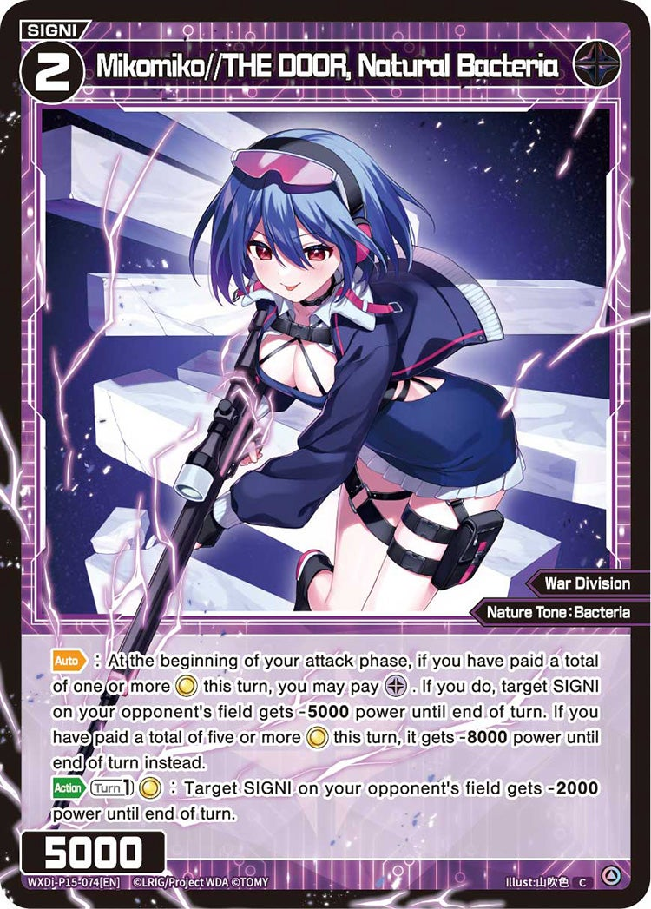

# Mikomiko//THE DOOR, Natural Bacteria

## Thông tin lá

| Trường | Giá trị |
| --- | --- |
| Mã in | WXDi-P15-074[EN] |
| Set | WXDi-P15[EN] |
| Số thứ tự | 074 |
| Loại thẻ | SIGNI |
| Vị trí | Main Deck |
| Số bản | — (set booster, không áp dụng) |
| Màu | Đen |
| Độ hiếm | C,C(P) |
| Minh họa | 山吹色 |
| Level | 2 |
| Limit | — |
| Power | 5000 |
| LRIG type / Class | War Division/Nature Tone：Bacteria |
| Team / Master | — |
| Cost | — |
| Grow cost | — |
| Use timing | — |
| Life Burst | Không |

## Card text chính thức

[Auto]: At the beginning of your attack phase, if you have paid a total of one or more {Coin Icon} this turn, you may pay {Black}. If you do, target SIGNI on your opponent's field gets -5000 power until end of turn. If you have paid a total of five or more {Coin Icon} this turn, it gets -8000 power until end of turn instead.
[Action] {1/Turn} {Coin Icon}: Target SIGNI on your opponent's field gets -2000 power until end of turn.

## Power text / Life Burst

—

## Ghi chú minh họa
Artist: 山吹色. Ảnh C được tải từ Card List tiếng Anh.

## FAQ chính thức

**Q. If I paid a total of five or more coins this turn when the [Auto] ability is triggered, do I have to pay the {black}?**
A. Yes, you must pay {black}. The only effect that would change if you had paid five or more coins would be the -5000 changing to -8000.

**Q. My SIGNI attacked when there is only one 《Exia, Blessed Angel Queen》 on my opponent's field, and its [Auto] ability triggered. If the condition “If you have paid a total of one or more {coin}  this turn” is not met, may I not target 《Exia, Blessed Angel Queen》?**
A. Yes, this ability does not even target it if the condition is not met. However, if the condition is met (If you have paid a total of one or more {coin}  this turn), this ability must be target it. If the conditions are met, you must be target your opponent's SIGNI first, and then {black} is paid or not.

## Ảnh biến thể

- [C(P)](../images/WXDi-P15-074P-EN.jpg)

## Nguồn
[Card List/FAQ chính thức](https://www.takaratomy.co.jp/products/en.wixoss/card/card.html?card_no=WXDi-P15-074%5BEN%5D ) · [Ảnh thẻ](https://www.takaratomy.co.jp/products/en.wixoss/card/thumb/WXDi-P15-074%5BEN%5D.jpg)
