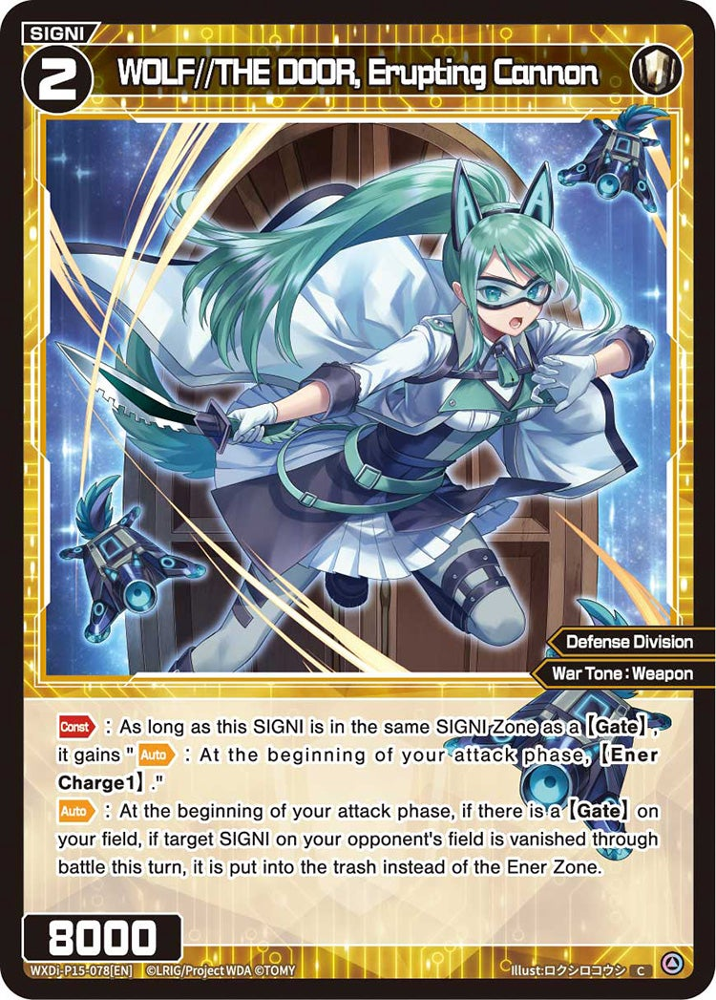

# WOLF//THE DOOR, Erupting Cannon

## Thông tin lá

| Trường | Giá trị |
| --- | --- |
| Mã in | WXDi-P15-078[EN] |
| Set | WXDi-P15[EN] |
| Số thứ tự | 078 |
| Loại thẻ | SIGNI |
| Vị trí | Main Deck |
| Số bản | — (set booster, không áp dụng) |
| Màu | Trắng |
| Độ hiếm | C,C(P) |
| Minh họa | ロクシロコウシ |
| Level | 2 |
| Limit | — |
| Power | 8000 |
| LRIG type / Class | Defense Division/War Tone：Weapon |
| Team / Master | — |
| Cost | — |
| Grow cost | — |
| Use timing | — |
| Life Burst | Không |

## Card text chính thức

[Constant]: As long as this SIGNI is in the same SIGNI Zone as a 【Gate】, it gains "[Auto]: At the beginning of your attack phase, 【Ener Charge 1】."
[Auto]: At the beginning of your attack phase, if there is a 【Gate】 on your field, if target SIGNI on your opponent's field is vanished through battle this turn, it is put into the trash instead of the Ener Zone.

## Power text / Life Burst

—

## Ghi chú minh họa
Artist: ロクシロコウシ. Ảnh C được tải từ Card List tiếng Anh.

## FAQ chính thức

**Q. What is [Gate]?**
A. You may put [Gate] in a SIGNI Zone due to the effect of this card. You may put up to one [Gate] per SIGNI Zone. However, the presence or absence of a [Gate] may change the effect of some cards.

**Q. When there is only one 《Exia, Blessed Angel Queen》 on my opponent's field, this SIGNI's [Auto] ability at the beginning of its attack phase is triggered. If the condition “If you have [Gate] in your field” is not met, may I not target 《Exia, Blessed Angel Queen》?**
A. Yes, this ability does not even target it if the condition is not met. However, if the condition is met (If you have [Gate] in your field), this ability must be target it.

## Ảnh biến thể

- [C(P)](../images/WXDi-P15-078P-EN.jpg)

## Nguồn
[Card List/FAQ chính thức](https://www.takaratomy.co.jp/products/en.wixoss/card/card.html?card_no=WXDi-P15-078%5BEN%5D ) · [Ảnh thẻ](https://www.takaratomy.co.jp/products/en.wixoss/card/thumb/WXDi-P15-078%5BEN%5D.jpg)
