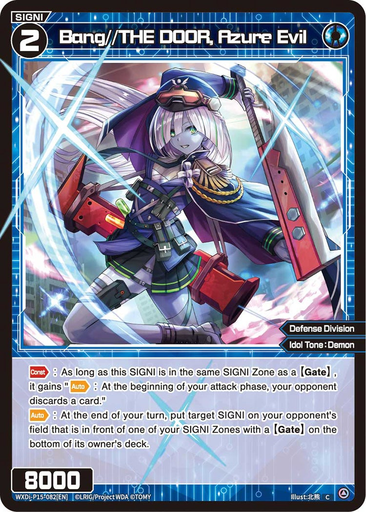

# Bang//THE DOOR, Azure Evil

## Thông tin lá

| Trường | Giá trị |
| --- | --- |
| Mã in | WXDi-P15-082[EN] |
| Set | WXDi-P15[EN] |
| Số thứ tự | 082 |
| Loại thẻ | SIGNI |
| Vị trí | Main Deck |
| Số bản | — (set booster, không áp dụng) |
| Màu | Xanh dương |
| Độ hiếm | C,C(P) |
| Minh họa | 北熊 |
| Level | 2 |
| Limit | — |
| Power | 8000 |
| LRIG type / Class | Defense Division/Idol Tone：Demon |
| Team / Master | — |
| Cost | — |
| Grow cost | — |
| Use timing | — |
| Life Burst | Không |

## Card text chính thức

[Constant]: As long as this SIGNI is in the same SIGNI Zone as a 【Gate】, it gains "[Auto]: At the beginning of your attack phase, your opponent discards a card."
[Auto]: At the end of your turn, put target SIGNI on your opponent's field that is in front of one of your SIGNI Zones with a 【Gate】 on the bottom of its owner's deck.

## Power text / Life Burst

—

## Ghi chú minh họa
Artist: 北熊. Ảnh C được tải từ Card List tiếng Anh.

## FAQ chính thức

**Q. What is [Gate]?**
A. You may put [Gate] in a SIGNI Zone due to the effect of this card. You may put up to one [Gate] per SIGNI Zone. However, the presence or absence of a [Gate] may change the effect of some cards.

**Q. When the [Auto] ability triggers, may I target my opponent's SIGNI in front of it even if there is no SIGNI in the SIGNI zone with [Gate]?**
A. Yes, you can.

## Ảnh biến thể

- [C(P)](../images/WXDi-P15-082P-EN.jpg)

## Nguồn
[Card List/FAQ chính thức](https://www.takaratomy.co.jp/products/en.wixoss/card/card.html?card_no=WXDi-P15-082%5BEN%5D ) · [Ảnh thẻ](https://www.takaratomy.co.jp/products/en.wixoss/card/thumb/WXDi-P15-082%5BEN%5D.jpg)
