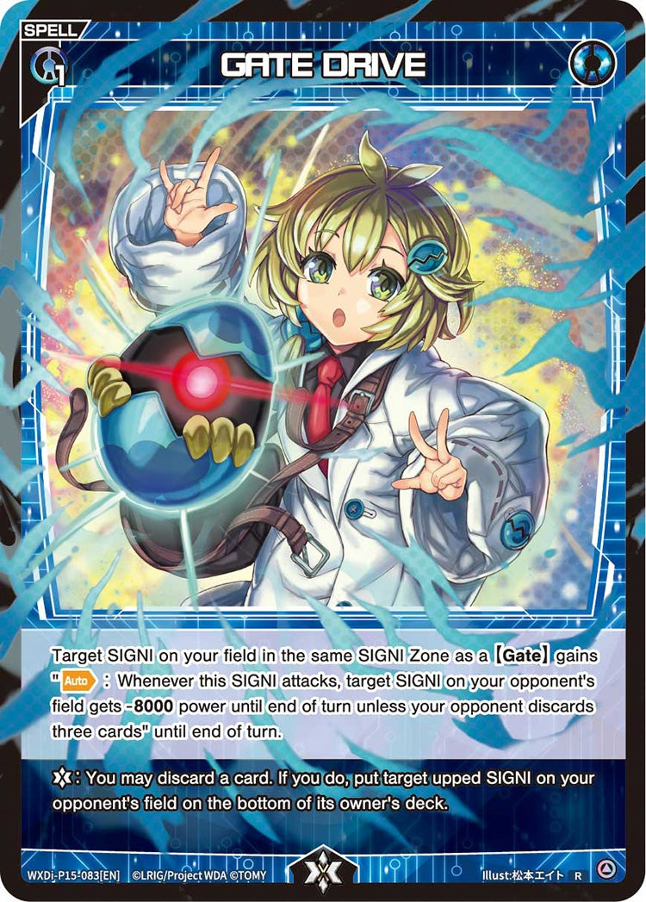

# GATE DRIVE

## Thông tin lá

| Trường | Giá trị |
| --- | --- |
| Mã in | WXDi-P15-083[EN] |
| Set | WXDi-P15[EN] |
| Số thứ tự | 083 |
| Loại thẻ | SPELL |
| Vị trí | Main Deck |
| Số bản | — (set booster, không áp dụng) |
| Màu | Xanh dương |
| Độ hiếm | R,R(P) |
| Minh họa | 松本エイト |
| Level | — |
| Limit | — |
| Power | 0 |
| LRIG type / Class | — |
| Team / Master | — |
| Cost | 《U》×１ |
| Grow cost | — |
| Use timing | — |
| Life Burst | Có |

## Card text chính thức

Target SIGNI on your field in the same SIGNI Zone as a 【Gate】 gains "[Auto]: Whenever this SIGNI attacks, target SIGNI on your opponent's field gets -8000 power until end of turn unless your opponent discards three cards" until end of turn.

## Power text / Life Burst

You may discard a card. If you do, put target upped SIGNI on your opponent's field on the bottom of its owner's deck.

## Ghi chú minh họa
Artist: 松本エイト. Ảnh R được tải từ Card List tiếng Anh.

## FAQ chính thức

**Q. What is [Gate]?**
A. You may put [Gate] in a SIGNI Zone due to the effect of this card. You may put up to one [Gate] per SIGNI Zone. However, the presence or absence of a [Gate] may change the effect of some cards.

## Ảnh biến thể

- [R(P)](../images/WXDi-P15-083P-EN.jpg)

## Nguồn
[Card List/FAQ chính thức](https://www.takaratomy.co.jp/products/en.wixoss/card/card.html?card_no=WXDi-P15-083%5BEN%5D ) · [Ảnh thẻ](https://www.takaratomy.co.jp/products/en.wixoss/card/thumb/WXDi-P15-083%5BEN%5D.jpg)
