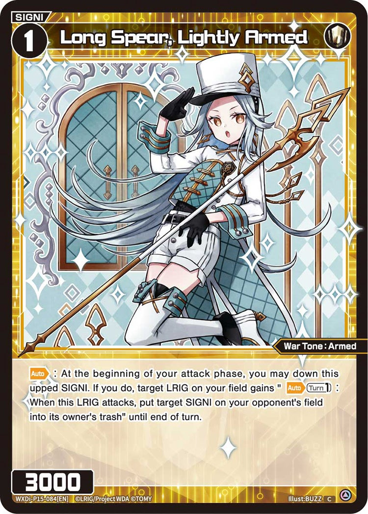

# Long Spear, Lightly Armed

## Thông tin lá

| Trường | Giá trị |
| --- | --- |
| Mã in | WXDi-P15-084[EN] |
| Set | WXDi-P15[EN] |
| Số thứ tự | 084 |
| Loại thẻ | SIGNI |
| Vị trí | Main Deck |
| Số bản | — (set booster, không áp dụng) |
| Màu | Trắng |
| Độ hiếm | C,C(P) |
| Minh họa | BUZZ |
| Level | 1 |
| Limit | — |
| Power | 3000 |
| LRIG type / Class | War Tone：Armed |
| Team / Master | — |
| Cost | — |
| Grow cost | — |
| Use timing | — |
| Life Burst | Không |

## Card text chính thức

[Auto]: At the beginning of your attack phase, you may down this upped SIGNI. If you do, target LRIG on your field gains "[Auto] {1/Turn}: When this LRIG attacks, put target SIGNI on your opponent's field into its owner's trash" until end of turn.

## Power text / Life Burst

—

## Ghi chú minh họa
Artist: BUZZ. Ảnh C được tải từ Card List tiếng Anh.

## FAQ chính thức

**Q. There are two 《Long Spear, Lightly Armed》 on my field, and at the beginning of the attack phase, each of them is downed by its ability. Does my LRIG gain more than one [Auto] abilities?**
A. Yes, your LRIG gains the abilities from the two 《Long Spear, Lightly Armed》, so when your LRIG attacks, you can put two of your opponent's SIGNI into their owner's trash.

## Ảnh biến thể

- [C(P)](../images/WXDi-P15-084P-EN.jpg)

## Nguồn
[Card List/FAQ chính thức](https://www.takaratomy.co.jp/products/en.wixoss/card/card.html?card_no=WXDi-P15-084%5BEN%5D ) · [Ảnh thẻ](https://www.takaratomy.co.jp/products/en.wixoss/card/thumb/WXDi-P15-084%5BEN%5D.jpg)
