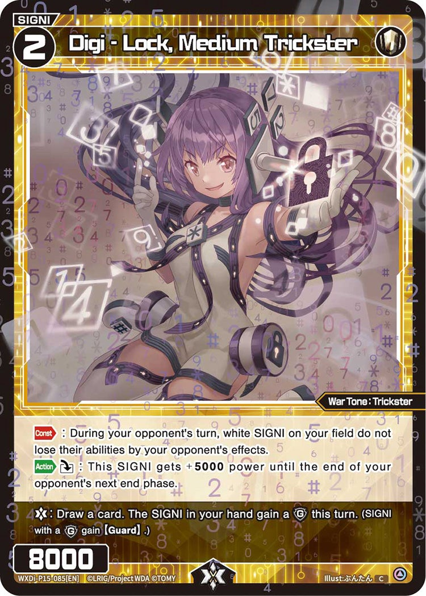

# Digi - Lock, Medium Trickster

## Thông tin lá

| Trường | Giá trị |
| --- | --- |
| Mã in | WXDi-P15-085[EN] |
| Set | WXDi-P15[EN] |
| Số thứ tự | 085 |
| Loại thẻ | SIGNI |
| Vị trí | Main Deck |
| Số bản | — (set booster, không áp dụng) |
| Màu | Trắng |
| Độ hiếm | C,C(P) |
| Minh họa | ぶんたん |
| Level | 2 |
| Limit | — |
| Power | 8000 |
| LRIG type / Class | War Tone：Trickster |
| Team / Master | — |
| Cost | — |
| Grow cost | — |
| Use timing | — |
| Life Burst | Có |

## Card text chính thức

[Constant]: During your opponent's turn, white SIGNI on your field do not lose their abilities by your opponent's effects.
[Action] {Down}: This SIGNI gets +5000 power until the end of your opponent's next end phase.

## Power text / Life Burst

Draw a card. The SIGNI in your hand gain a {Guard Icon} this turn. (SIGNI with a {Guard Icon} gain 【Guard】.)

## Ghi chú minh họa
Artist: ぶんたん. Ảnh C được tải từ Card List tiếng Anh.

## FAQ chính thức

**Q. If my SIGNI doesn't “lose all abilities,” does it get a negative power modifier?**
A. Yes, it will get a negative power modifier. Losing abilities is an effect that erases the text in text area of card, and 《Digi - Lock, Medium Trickster》 prevents it. Effects that interfere with power, level, class, etc. outside of the text area of card are received, so effects that negate power are also received.

## Ảnh biến thể

- [C(P)](../images/WXDi-P15-085P-EN.jpg)

## Nguồn
[Card List/FAQ chính thức](https://www.takaratomy.co.jp/products/en.wixoss/card/card.html?card_no=WXDi-P15-085%5BEN%5D ) · [Ảnh thẻ](https://www.takaratomy.co.jp/products/en.wixoss/card/thumb/WXDi-P15-085%5BEN%5D.jpg)
