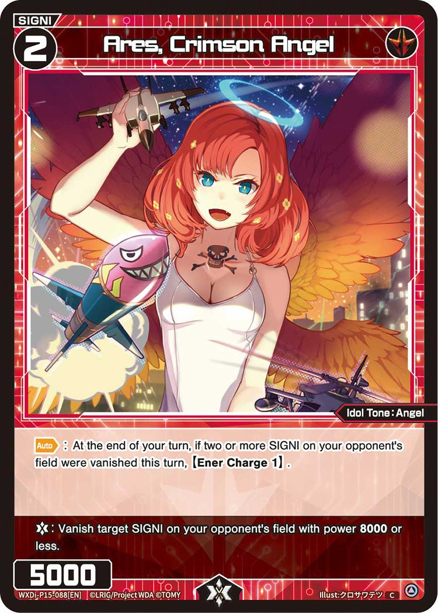

# Ares, Crimson Angel

## Thông tin lá

| Trường | Giá trị |
| --- | --- |
| Mã in | WXDi-P15-088[EN] |
| Set | WXDi-P15[EN] |
| Số thứ tự | 088 |
| Loại thẻ | SIGNI |
| Vị trí | Main Deck |
| Số bản | — (set booster, không áp dụng) |
| Màu | Đỏ |
| Độ hiếm | C,C(P) |
| Minh họa | クロサワテツ |
| Level | 2 |
| Limit | — |
| Power | 5000 |
| LRIG type / Class | Idol Tone：Angel |
| Team / Master | — |
| Cost | — |
| Grow cost | — |
| Use timing | — |
| Life Burst | Có |

## Card text chính thức

[Auto]: At the end of your turn, if two or more SIGNI on your opponent's field were vanished this turn, 【Ener Charge 1】.

## Power text / Life Burst

Vanish target SIGNI on your opponent's field with power 8000 or less.

## Ghi chú minh họa
Artist: クロサワテツ. Ảnh C được tải từ Card List tiếng Anh.

## FAQ chính thức

**Q. Does SIGNI that is put into its owner's trash by an effect such as 《Hanare//Dark Sphere》 that “if a SIGNI is vanished, it is put into the trash instead of the Ener Zone” count toward the condition for this [Auto] ability?**
A. Yes, it is counted. The effect “if a SIGNI is vanished, it is put into the trash instead of the Ener Zone” only replaces where it is put if it is vanished, and it is still vanished.

## Ảnh biến thể

- [C(P)](../images/WXDi-P15-088P-EN.jpg)

## Nguồn
[Card List/FAQ chính thức](https://www.takaratomy.co.jp/products/en.wixoss/card/card.html?card_no=WXDi-P15-088%5BEN%5D ) · [Ảnh thẻ](https://www.takaratomy.co.jp/products/en.wixoss/card/thumb/WXDi-P15-088%5BEN%5D.jpg)
