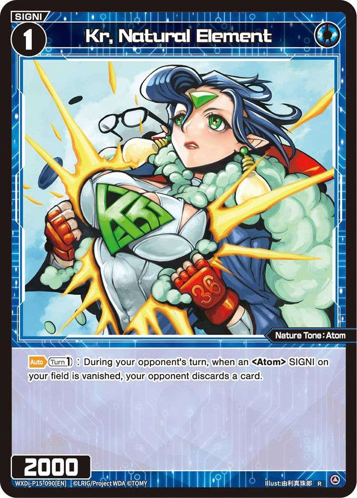

# Kr, Natural Element

## Thông tin lá

| Trường | Giá trị |
| --- | --- |
| Mã in | WXDi-P15-090[EN] |
| Set | WXDi-P15[EN] |
| Số thứ tự | 090 |
| Loại thẻ | SIGNI |
| Vị trí | Main Deck |
| Số bản | — (set booster, không áp dụng) |
| Màu | Xanh dương |
| Độ hiếm | R,R(P) |
| Minh họa | 由利真珠郎 |
| Level | 1 |
| Limit | — |
| Power | 2000 |
| LRIG type / Class | Nature Tone：Atom |
| Team / Master | — |
| Cost | — |
| Grow cost | — |
| Use timing | — |
| Life Burst | Không |

## Card text chính thức

[Auto] {1/Turn}: During your opponent's turn, when an <Atom> SIGNI on your field is vanished, your opponent discards a card.

## Power text / Life Burst

—

## Ghi chú minh họa
Artist: 由利真珠郎. Ảnh R được tải từ Card List tiếng Anh.

## FAQ chính thức

**Q. If this SIGNI is vanished on my opponent's turn, does this SIGNI's [Auto] ability trigger?**
A. Yes, this SIGNI is also <Atom>, so it is triggered.

## Ảnh biến thể

- [R(P)](../images/WXDi-P15-090P-EN.jpg)

## Nguồn
[Card List/FAQ chính thức](https://www.takaratomy.co.jp/products/en.wixoss/card/card.html?card_no=WXDi-P15-090%5BEN%5D ) · [Ảnh thẻ](https://www.takaratomy.co.jp/products/en.wixoss/card/thumb/WXDi-P15-090%5BEN%5D.jpg)
