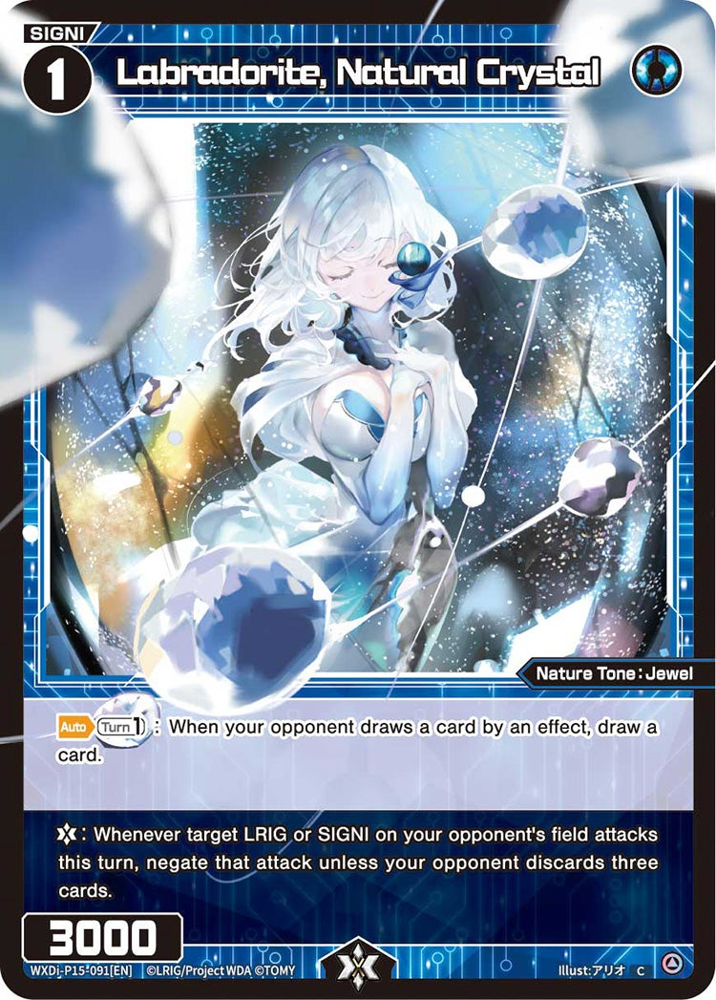

# Labradorite, Natural Crystal

## Thông tin lá

| Trường | Giá trị |
| --- | --- |
| Mã in | WXDi-P15-091[EN] |
| Set | WXDi-P15[EN] |
| Số thứ tự | 091 |
| Loại thẻ | SIGNI |
| Vị trí | Main Deck |
| Số bản | — (set booster, không áp dụng) |
| Màu | Xanh dương |
| Độ hiếm | C,C(P) |
| Minh họa | アリオ |
| Level | 1 |
| Limit | — |
| Power | 3000 |
| LRIG type / Class | Nature Tone：Jewel |
| Team / Master | — |
| Cost | — |
| Grow cost | — |
| Use timing | — |
| Life Burst | Có |

## Card text chính thức

[Auto] {1/Turn}: When your opponent draws a card by an effect, draw a card.

## Power text / Life Burst

Whenever target LRIG or SIGNI on your opponent's field attacks this turn, negate that attack unless your opponent discards three cards.

## Ghi chú minh họa
Artist: アリオ. Ảnh C được tải từ Card List tiếng Anh.

## FAQ chính thức

**Q. If my opponent draws two cards as a result of the “draw two cards” effect, does this SIGNI's [Auto] ability trigger?**
A. Yes, it is triggered. This effect is not triggered when only one card is drawn, but when one or more cards are drawn by an effect.

## Ảnh biến thể

- [C(P)](../images/WXDi-P15-091P-EN.jpg)

## Nguồn
[Card List/FAQ chính thức](https://www.takaratomy.co.jp/products/en.wixoss/card/card.html?card_no=WXDi-P15-091%5BEN%5D ) · [Ảnh thẻ](https://www.takaratomy.co.jp/products/en.wixoss/card/thumb/WXDi-P15-091%5BEN%5D.jpg)
