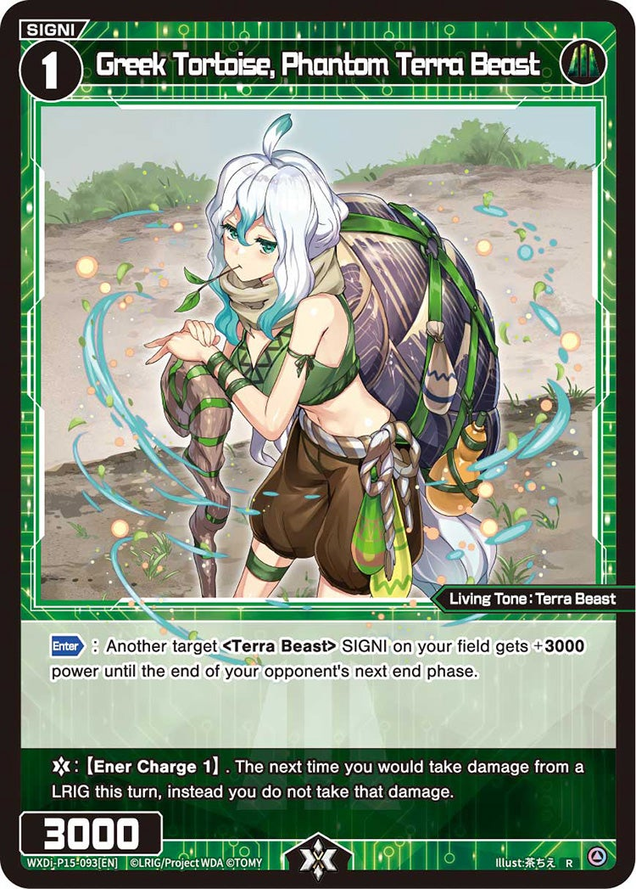

# Greek Tortoise, Phantom Terra Beast

## Thông tin lá

| Trường | Giá trị |
| --- | --- |
| Mã in | WXDi-P15-093[EN] |
| Set | WXDi-P15[EN] |
| Số thứ tự | 093 |
| Loại thẻ | SIGNI |
| Vị trí | Main Deck |
| Số bản | — (set booster, không áp dụng) |
| Màu | Xanh lá |
| Độ hiếm | R,R(P) |
| Minh họa | 茶ちえ |
| Level | 1 |
| Limit | — |
| Power | 3000 |
| LRIG type / Class | Living Tone：Terra Beast |
| Team / Master | — |
| Cost | — |
| Grow cost | — |
| Use timing | — |
| Life Burst | Có |

## Card text chính thức

[Enter]: Another target <Terra Beast> SIGNI on your field gets +3000 power until the end of your opponent's next end phase.

## Power text / Life Burst

【Ener Charge 1】. The next time you would take damage from a LRIG this turn, instead you do not take that damage.

## Ghi chú minh họa
Artist: 茶ちえ. Ảnh R được tải từ Card List tiếng Anh.

## FAQ chính thức

**Q. After this card's Life Burst resolves, I took damaged by an attack of my opponent's SIGNI. May this effect prevent the next attack by my opponent's LRIG?**
A. Yes, it can be prevented. This effect only applies to damage by the next LRIG, even if there is damage by SIGNI in between.

## Ảnh biến thể

- [R(P)](../images/WXDi-P15-093P-EN.jpg)

## Nguồn
[Card List/FAQ chính thức](https://www.takaratomy.co.jp/products/en.wixoss/card/card.html?card_no=WXDi-P15-093%5BEN%5D ) · [Ảnh thẻ](https://www.takaratomy.co.jp/products/en.wixoss/card/thumb/WXDi-P15-093%5BEN%5D.jpg)
