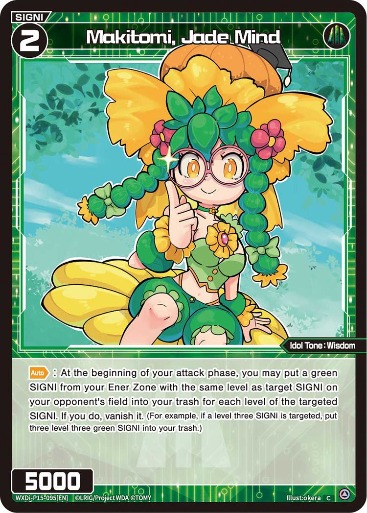

# Makitomi, Jade Mind

## Thông tin lá

| Trường | Giá trị |
| --- | --- |
| Mã in | WXDi-P15-095[EN] |
| Set | WXDi-P15[EN] |
| Số thứ tự | 095 |
| Loại thẻ | SIGNI |
| Vị trí | Main Deck |
| Số bản | — (set booster, không áp dụng) |
| Màu | Xanh lá |
| Độ hiếm | C,C(P) |
| Minh họa | okera |
| Level | 2 |
| Limit | — |
| Power | 5000 |
| LRIG type / Class | Idol Tone：Wisdom |
| Team / Master | — |
| Cost | — |
| Grow cost | — |
| Use timing | — |
| Life Burst | Không |

## Card text chính thức

[Auto]: At the beginning of your attack phase, you may put a green SIGNI from your Ener Zone with the same level as target SIGNI on your opponent's field into your trash for each level of the targeted SIGNI. If you do, vanish it. (For example, if a level three SIGNI is targeted, put three level three green SIGNI into your trash.)

## Power text / Life Burst

—

## Ghi chú minh họa
Artist: okera. Ảnh C được tải từ Card List tiếng Anh.

## FAQ chính thức

— (không có FAQ riêng cho mã này trên trang FAQ tiếng Anh.)

## Ảnh biến thể

- [C(P)](../images/WXDi-P15-095P-EN.jpg)

## Nguồn
[Card List/FAQ chính thức](https://www.takaratomy.co.jp/products/en.wixoss/card/card.html?card_no=WXDi-P15-095%5BEN%5D ) · [Ảnh thẻ](https://www.takaratomy.co.jp/products/en.wixoss/card/thumb/WXDi-P15-095%5BEN%5D.jpg)
