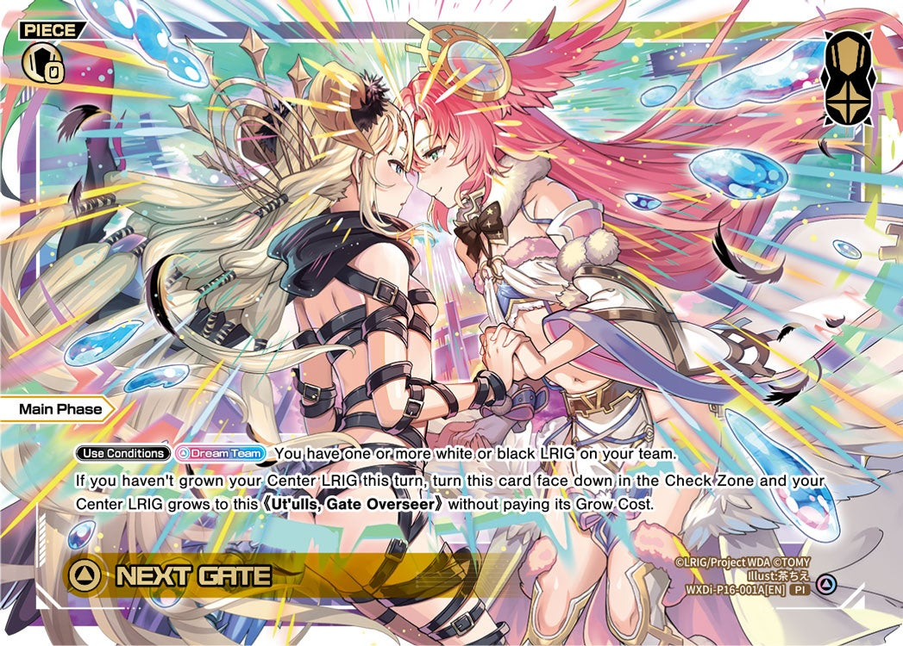

# NEXT GATE

## Thông tin lá

| Trường | Giá trị |
| --- | --- |
| Mã in | WXDi-P16-001A[EN] |
| Set | WXDi-P16[EN] |
| Số thứ tự | 001A |
| Loại thẻ | PIECE |
| Vị trí | LRIG Deck |
| Số bản | — (set booster, không áp dụng) |
| Màu | Trắng / đen |
| Độ hiếm | PI,LRP,UR |
| Minh họa | 茶ちえ |
| Level | — |
| Limit | — |
| Power | 0 |
| LRIG type / Class | — |
| Team / Master | — |
| Cost | 《W》×０ |
| Grow cost | — |
| Use timing | Main Phase |
| Life Burst | Không |

## Card text chính thức

[Use Conditions] [Dream Team] You have one or more white or black LRIG on your team.

If you haven't grown your Center LRIG this turn, turn this card face down in the Check Zone and your Center LRIG grows to this 《Ut'ulls, Gate Overseer》 without paying its Grow Cost.

## Power text / Life Burst

—

## Ghi chú minh họa
Artist: 茶ちえ. Ảnh PI được tải từ Card List tiếng Anh.

## FAQ chính thức

— (không có FAQ riêng cho mã này trên trang FAQ tiếng Anh.)

## Ảnh biến thể

- [LRP](../images/WXDi-P16-001AP-EN.jpg)
- [UR](../images/WXDi-P16-001AU-EN.jpg)

## Nguồn
[Card List/FAQ chính thức](https://www.takaratomy.co.jp/products/en.wixoss/card/card.html?card_no=WXDi-P16-001A%5BEN%5D ) · [Ảnh thẻ](https://www.takaratomy.co.jp/products/en.wixoss/card/thumb/WXDi-P16-001A%5BEN%5D.jpg)
