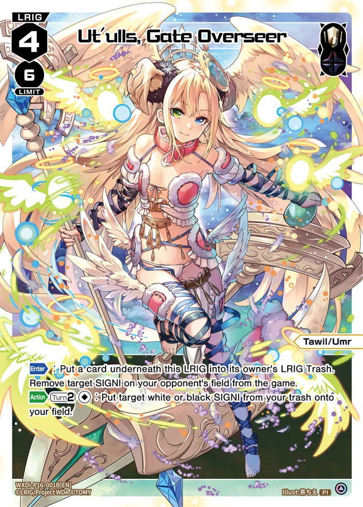

# Ut'ulls, Gate Overseer

## Thông tin lá

| Trường | Giá trị |
| --- | --- |
| Mã in | WXDi-P16-001B[EN] |
| Set | WXDi-P16[EN] |
| Số thứ tự | 001B |
| Loại thẻ | LRIG |
| Vị trí | LRIG Deck |
| Số bản | — (set booster, không áp dụng) |
| Màu | Trắng / đen |
| Độ hiếm | PI,LRP,UR |
| Minh họa | 茶ちえ |
| Level | 4 |
| Limit | 6 |
| Power | 0 |
| LRIG type / Class | Tawil/Umr |
| Team / Master | — |
| Cost | — |
| Grow cost | — |
| Use timing | — |
| Life Burst | Không |

## Card text chính thức

[Enter]: Put a card underneath this LRIG into its owner's LRIG Trash. Remove target SIGNI on your opponent's field from the game.
[Action] {2/Turn} {Colorless}: Put target white or black SIGNI from your trash onto your field.

## Power text / Life Burst

—

## Ghi chú minh họa
Artist: 茶ちえ. Ảnh PI được tải từ Card List tiếng Anh.

## FAQ chính thức

— (không có FAQ riêng cho mã này trên trang FAQ tiếng Anh.)

## Ảnh biến thể

- [LRP](../images/WXDi-P16-001BP-EN.jpg)
- [UR](../images/WXDi-P16-001BU-EN.jpg)

## Nguồn
[Card List/FAQ chính thức](https://www.takaratomy.co.jp/products/en.wixoss/card/card.html?card_no=WXDi-P16-001B%5BEN%5D ) · [Ảnh thẻ](https://www.takaratomy.co.jp/products/en.wixoss/card/thumb/WXDi-P16-001B%5BEN%5D.jpg)
