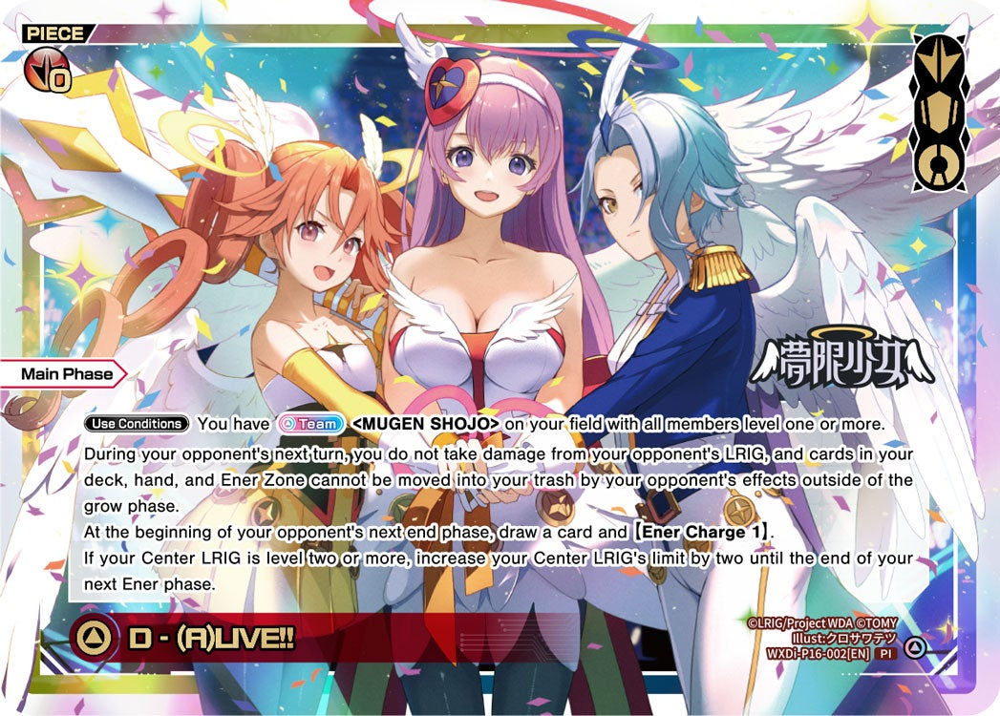

# D - (A)LIVE!!

## Thông tin lá

| Trường | Giá trị |
| --- | --- |
| Mã in | WXDi-P16-002[EN] |
| Set | WXDi-P16[EN] |
| Số thứ tự | 002 |
| Loại thẻ | PIECE |
| Vị trí | LRIG Deck |
| Số bản | — (set booster, không áp dụng) |
| Màu | Đỏ / trắng / xanh dương |
| Độ hiếm | PI,LRP |
| Minh họa | クロサワテツ |
| Level | — |
| Limit | — |
| Power | 0 |
| LRIG type / Class | — |
| Team / Master | — |
| Cost | 《R》×０ |
| Grow cost | — |
| Use timing | Main Phase |
| Life Burst | Không |

## Card text chính thức

[Use Conditions] You have [Team] <MUGEN SHOJO> on your field with all members level one or more.

During your opponent's next turn, you do not take damage from your opponent's LRIG, and cards in your deck, hand, and Ener Zone cannot be moved into your trash by your opponent's effects outside of the grow phase.
At the beginning of your opponent's next end phase, draw a card and 【Ener Charge 1】.
If your Center LRIG is level two or more, increase your Center LRIG's limit by two until the end of your next Ener phase.

## Power text / Life Burst

—

## Ghi chú minh họa
Artist: クロサワテツ. Ảnh PI được tải từ Card List tiếng Anh.

## FAQ chính thức

— (không có FAQ riêng cho mã này trên trang FAQ tiếng Anh.)

## Ảnh biến thể

- [LRP](../images/WXDi-P16-002P-EN.jpg)

## Nguồn
[Card List/FAQ chính thức](https://www.takaratomy.co.jp/products/en.wixoss/card/card.html?card_no=WXDi-P16-002%5BEN%5D ) · [Ảnh thẻ](https://www.takaratomy.co.jp/products/en.wixoss/card/thumb/WXDi-P16-002%5BEN%5D.jpg)
