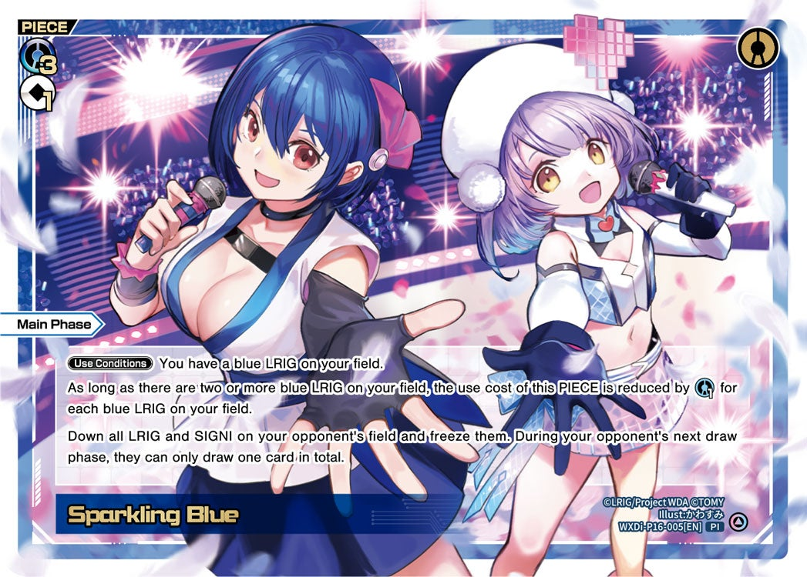

# Sparkling Blue

## Thông tin lá

| Trường | Giá trị |
| --- | --- |
| Mã in | WXDi-P16-005[EN] |
| Set | WXDi-P16[EN] |
| Số thứ tự | 005 |
| Loại thẻ | PIECE |
| Vị trí | LRIG Deck |
| Số bản | — (set booster, không áp dụng) |
| Màu | Xanh dương |
| Độ hiếm | PI,LRP |
| Minh họa | かわすみ |
| Level | — |
| Limit | — |
| Power | 0 |
| LRIG type / Class | — |
| Team / Master | — |
| Cost | 《U》×３ / 《C》×１ |
| Grow cost | — |
| Use timing | Main Phase |
| Life Burst | Không |

## Card text chính thức

[Use Conditions] You have a blue LRIG on your field.

As long as there are two or more blue LRIG on your field, the use cost of this PIECE is reduced by {Bluex1} for each blue LRIG on your field.

Down all LRIG and SIGNI on your opponent's field and freeze them. During your opponent's next draw phase, they can only draw one card in total.

## Power text / Life Burst

—

## Ghi chú minh họa
Artist: かわすみ. Ảnh PI được tải từ Card List tiếng Anh.

## FAQ chính thức

— (không có FAQ riêng cho mã này trên trang FAQ tiếng Anh.)

## Ảnh biến thể

- [LRP](../images/WXDi-P16-005P-EN.jpg)

## Nguồn
[Card List/FAQ chính thức](https://www.takaratomy.co.jp/products/en.wixoss/card/card.html?card_no=WXDi-P16-005%5BEN%5D ) · [Ảnh thẻ](https://www.takaratomy.co.jp/products/en.wixoss/card/thumb/WXDi-P16-005%5BEN%5D.jpg)
