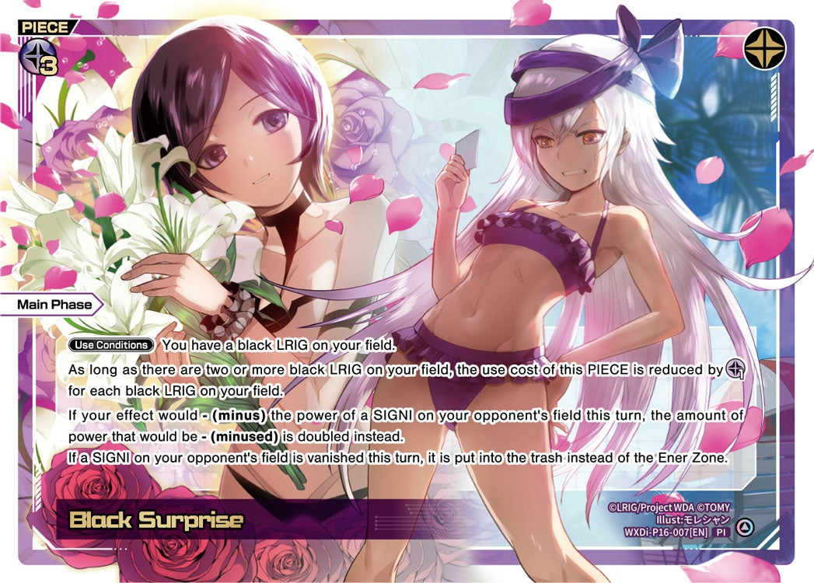

# Black Surprise

## Thông tin lá

| Trường | Giá trị |
| --- | --- |
| Mã in | WXDi-P16-007[EN] |
| Set | WXDi-P16[EN] |
| Số thứ tự | 007 |
| Loại thẻ | PIECE |
| Vị trí | LRIG Deck |
| Số bản | — (set booster, không áp dụng) |
| Màu | Đen |
| Độ hiếm | PI,LRP |
| Minh họa | モレシャン |
| Level | — |
| Limit | — |
| Power | 0 |
| LRIG type / Class | — |
| Team / Master | — |
| Cost | 《B》×３ |
| Grow cost | — |
| Use timing | Main Phase |
| Life Burst | Không |

## Card text chính thức

[Use Conditions] You have a black LRIG on your field.

As long as there are two or more black LRIG on your field, the use cost of this PIECE is reduced by {Blackx1} for each black LRIG on your field.

If your effect would - (minus) the power of a SIGNI on your opponent's field this turn, the amount of power that would be - (minused) is doubled instead.
If a SIGNI on your opponent's field is vanished this turn, it is put into the trash instead of the Ener Zone.

## Power text / Life Burst

—

## Ghi chú minh họa
Artist: モレシャン. Ảnh PI được tải từ Card List tiếng Anh.

## FAQ chính thức

— (không có FAQ riêng cho mã này trên trang FAQ tiếng Anh.)

## Ảnh biến thể

- [LRP](../images/WXDi-P16-007P-EN.jpg)

## Nguồn
[Card List/FAQ chính thức](https://www.takaratomy.co.jp/products/en.wixoss/card/card.html?card_no=WXDi-P16-007%5BEN%5D ) · [Ảnh thẻ](https://www.takaratomy.co.jp/products/en.wixoss/card/thumb/WXDi-P16-007%5BEN%5D.jpg)
