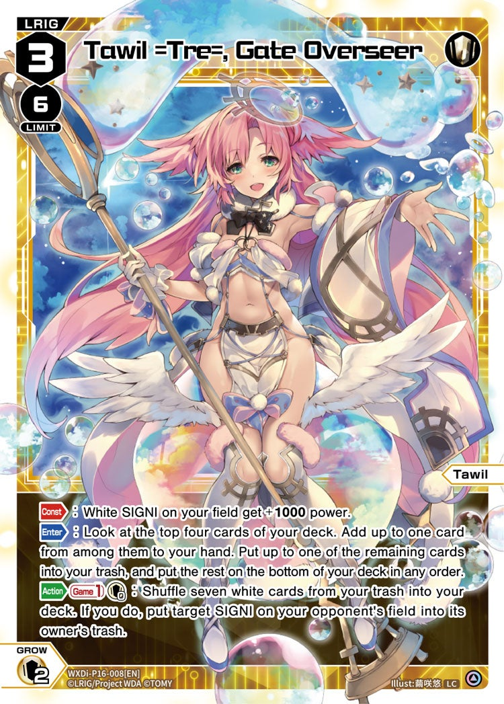

# Tawil =Tre=, Gate Overseer

## Thông tin lá

| Trường | Giá trị |
| --- | --- |
| Mã in | WXDi-P16-008[EN] |
| Set | WXDi-P16[EN] |
| Số thứ tự | 008 |
| Loại thẻ | LRIG |
| Vị trí | LRIG Deck |
| Số bản | — (set booster, không áp dụng) |
| Màu | Trắng |
| Độ hiếm | LC,LR,LRP,UR |
| Minh họa | 繭咲悠 |
| Level | 3 |
| Limit | 6 |
| Power | 0 |
| LRIG type / Class | Tawil |
| Team / Master | — |
| Cost | — |
| Grow cost | 《W》×２ |
| Use timing | — |
| Life Burst | Không |

## Card text chính thức

[Constant]: White SIGNI on your field get +1000 power.
[Enter]: Look at the top four cards of your deck. Add up to one card from among them to your hand. Put up to one of the remaining cards into your trash, and put the rest on the bottom of your deck in any order.
[Action] {1/Game} {Whitex0}: Shuffle seven white cards from your trash into your deck. If you do, put target SIGNI on your opponent's field into its owner's trash.

## Power text / Life Burst

—

## Ghi chú minh họa
Artist: 繭咲悠. Ảnh LC được tải từ Card List tiếng Anh.

## FAQ chính thức

— (không có FAQ riêng cho mã này trên trang FAQ tiếng Anh.)

## Ảnh biến thể

- [LRP](../images/WXDi-P16-008P-EN.jpg)
- [LR](../images/WXDi-P16-008R-EN.jpg)
- [UR](../images/WXDi-P16-008U-EN.jpg)

## Nguồn
[Card List/FAQ chính thức](https://www.takaratomy.co.jp/products/en.wixoss/card/card.html?card_no=WXDi-P16-008%5BEN%5D ) · [Ảnh thẻ](https://www.takaratomy.co.jp/products/en.wixoss/card/thumb/WXDi-P16-008%5BEN%5D.jpg)
