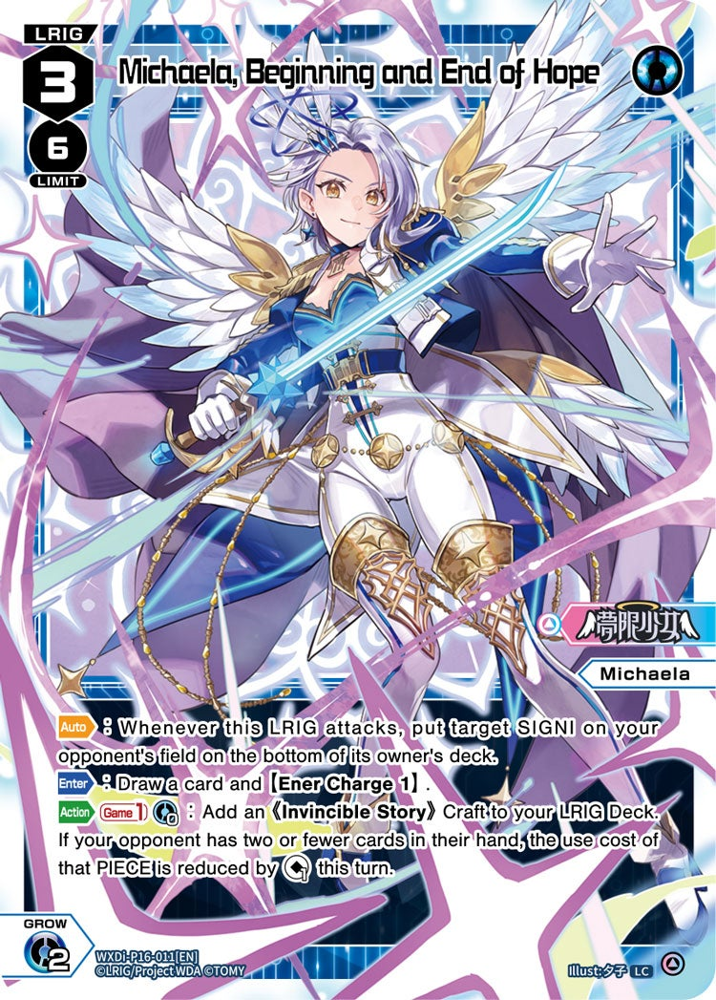

# Michaela, Beginning and End of Hope

## Thông tin lá

| Trường | Giá trị |
| --- | --- |
| Mã in | WXDi-P16-011[EN] |
| Set | WXDi-P16[EN] |
| Số thứ tự | 011 |
| Loại thẻ | LRIG |
| Vị trí | LRIG Deck |
| Số bản | — (set booster, không áp dụng) |
| Màu | Xanh dương |
| Độ hiếm | LC,LR,LRP,UR |
| Minh họa | 夕子 |
| Level | 3 |
| Limit | 6 |
| Power | 0 |
| LRIG type / Class | Michaela |
| Team / Master | MUGEN SHOJO |
| Cost | — |
| Grow cost | 《U》×２ |
| Use timing | — |
| Life Burst | Không |

## Card text chính thức

[Auto]: Whenever this LRIG attacks, put target SIGNI on your opponent's field on the bottom of its owner's deck.
[Enter]: Draw a card and 【Ener Charge 1】.
[Action] {1/Game} {Bluex0}: Add an 《Invincible Story》 Craft to your LRIG Deck. If your opponent has two or fewer cards in their hand, the use cost of that PIECE is reduced by {Colorlessx1} this turn.

## Power text / Life Burst

—

## Ghi chú minh họa
Artist: 夕子. Ảnh LC được tải từ Card List tiếng Anh.

## FAQ chính thức

— (không có FAQ riêng cho mã này trên trang FAQ tiếng Anh.)

## Ảnh biến thể

- [LRP](../images/WXDi-P16-011P-EN.jpg)
- [LR](../images/WXDi-P16-011R-EN.jpg)
- [UR](../images/WXDi-P16-011U-EN.jpg)

## Nguồn
[Card List/FAQ chính thức](https://www.takaratomy.co.jp/products/en.wixoss/card/card.html?card_no=WXDi-P16-011%5BEN%5D ) · [Ảnh thẻ](https://www.takaratomy.co.jp/products/en.wixoss/card/thumb/WXDi-P16-011%5BEN%5D.jpg)
