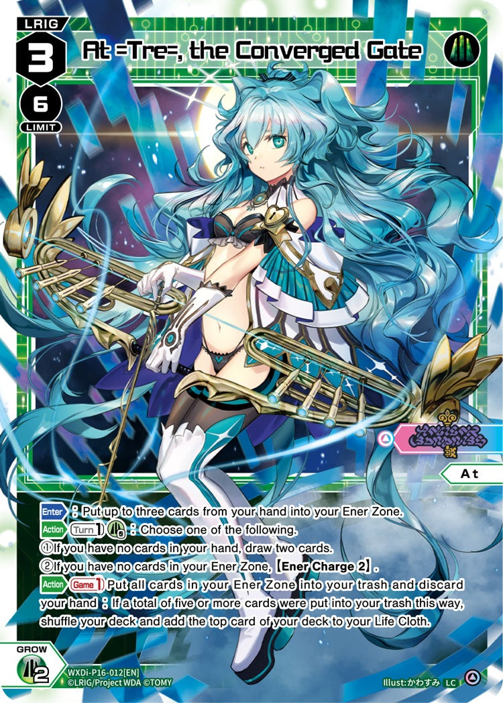

# At =Tre=, the Converged Gate

## Thông tin lá

| Trường | Giá trị |
| --- | --- |
| Mã in | WXDi-P16-012[EN] |
| Set | WXDi-P16[EN] |
| Số thứ tự | 012 |
| Loại thẻ | LRIG |
| Vị trí | LRIG Deck |
| Số bản | — (set booster, không áp dụng) |
| Màu | Xanh lá |
| Độ hiếm | LC,LR,LRP,UR |
| Minh họa | かわすみ |
| Level | 3 |
| Limit | 6 |
| Power | 0 |
| LRIG type / Class | At |
| Team / Master | Ancient Surprise |
| Cost | — |
| Grow cost | 《G》×２ |
| Use timing | — |
| Life Burst | Không |

## Card text chính thức

[Enter]: Put up to three cards from your hand into your Ener Zone.
[Action] {1/Turn} {Greenx0}: Choose one of the following.
①If you have no cards in your hand, draw two cards.
②If you have no cards in your Ener Zone, 【Ener Charge 2】.
[Action] {1/Game} Put all cards in your Ener Zone into your trash and discard your hand: If a total of five or more cards were put into your trash this way, shuffle your deck and add the top card of your deck to your Life Cloth.

## Power text / Life Burst

—

## Ghi chú minh họa
Artist: かわすみ. Ảnh LC được tải từ Card List tiếng Anh.

## FAQ chính thức

— (không có FAQ riêng cho mã này trên trang FAQ tiếng Anh.)

## Ảnh biến thể

- [LRP](../images/WXDi-P16-012P-EN.jpg)
- [LR](../images/WXDi-P16-012R-EN.jpg)
- [UR](../images/WXDi-P16-012U-EN.jpg)

## Nguồn
[Card List/FAQ chính thức](https://www.takaratomy.co.jp/products/en.wixoss/card/card.html?card_no=WXDi-P16-012%5BEN%5D ) · [Ảnh thẻ](https://www.takaratomy.co.jp/products/en.wixoss/card/thumb/WXDi-P16-012%5BEN%5D.jpg)
