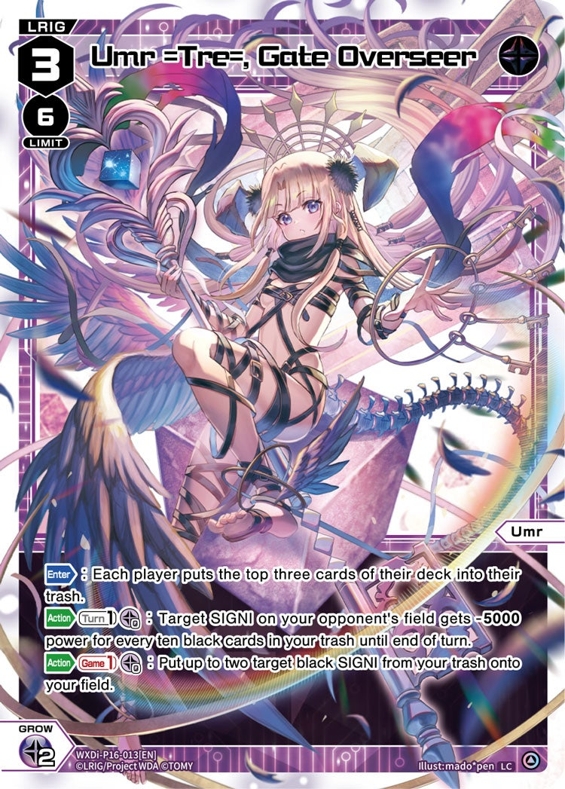

# Umr =Tre=, Gate Overseer

## Thông tin lá

| Trường | Giá trị |
| --- | --- |
| Mã in | WXDi-P16-013[EN] |
| Set | WXDi-P16[EN] |
| Số thứ tự | 013 |
| Loại thẻ | LRIG |
| Vị trí | LRIG Deck |
| Số bản | — (set booster, không áp dụng) |
| Màu | Đen |
| Độ hiếm | LC,LR,LRP,UR |
| Minh họa | mado*pen |
| Level | 3 |
| Limit | 6 |
| Power | 0 |
| LRIG type / Class | Umr |
| Team / Master | — |
| Cost | — |
| Grow cost | 《B》×２ |
| Use timing | — |
| Life Burst | Không |

## Card text chính thức

[Enter]: Each player puts the top three cards of their deck into their trash.
[Action] {1/Turn} {Blackx0}: Target SIGNI on your opponent's field gets -5000 power for every ten black cards in your trash until end of turn.
[Action] {1/Game} {Blackx0}: Put up to two target black SIGNI from your trash onto your field.

## Power text / Life Burst

—

## Ghi chú minh họa
Artist: mado*pen. Ảnh LC được tải từ Card List tiếng Anh.

## FAQ chính thức

— (không có FAQ riêng cho mã này trên trang FAQ tiếng Anh.)

## Ảnh biến thể

- [LRP](../images/WXDi-P16-013P-EN.jpg)
- [LR](../images/WXDi-P16-013R-EN.jpg)
- [UR](../images/WXDi-P16-013U-EN.jpg)

## Nguồn
[Card List/FAQ chính thức](https://www.takaratomy.co.jp/products/en.wixoss/card/card.html?card_no=WXDi-P16-013%5BEN%5D ) · [Ảnh thẻ](https://www.takaratomy.co.jp/products/en.wixoss/card/thumb/WXDi-P16-013%5BEN%5D.jpg)
