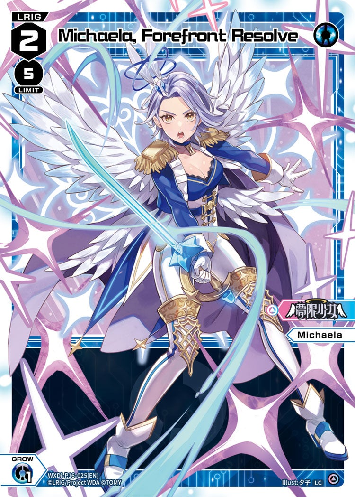

# Michaela, Forefront Resolve

## Thông tin lá

| Trường | Giá trị |
| --- | --- |
| Mã in | WXDi-P16-025[EN] |
| Set | WXDi-P16[EN] |
| Số thứ tự | 025 |
| Loại thẻ | LRIG |
| Vị trí | LRIG Deck |
| Số bản | — (set booster, không áp dụng) |
| Màu | Xanh dương |
| Độ hiếm | LC,LR |
| Minh họa | 夕子 |
| Level | 2 |
| Limit | 5 |
| Power | 0 |
| LRIG type / Class | Michaela |
| Team / Master | MUGEN SHOJO |
| Cost | — |
| Grow cost | 《U》×１ |
| Use timing | — |
| Life Burst | Không |

## Card text chính thức

—

## Power text / Life Burst

—

## Ghi chú minh họa
Artist: 夕子. Ảnh LC được tải từ Card List tiếng Anh.

## FAQ chính thức

— (không có FAQ riêng cho mã này trên trang FAQ tiếng Anh.)

## Ảnh biến thể

- [LR](../images/WXDi-P16-025R-EN.jpg)

## Nguồn
[Card List/FAQ chính thức](https://www.takaratomy.co.jp/products/en.wixoss/card/card.html?card_no=WXDi-P16-025%5BEN%5D ) · [Ảnh thẻ](https://www.takaratomy.co.jp/products/en.wixoss/card/thumb/WXDi-P16-025%5BEN%5D.jpg)
