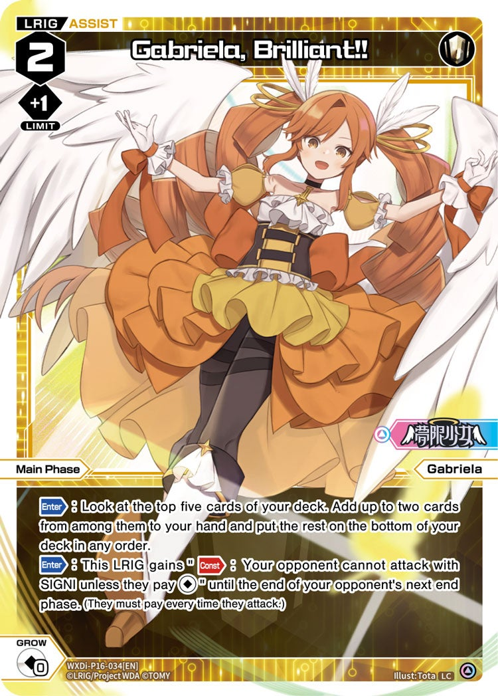

# Gabriela, Brilliant!!

## Thông tin lá

| Trường | Giá trị |
| --- | --- |
| Mã in | WXDi-P16-034[EN] |
| Set | WXDi-P16[EN] |
| Số thứ tự | 034 |
| Loại thẻ | ASSIST LRIG |
| Vị trí | LRIG Deck |
| Số bản | — (set booster, không áp dụng) |
| Màu | Trắng |
| Độ hiếm | LC,LC(P) |
| Minh họa | Tota |
| Level | 2 |
| Limit | ＋１ |
| Power | 0 |
| LRIG type / Class | Gabriela |
| Team / Master | MUGEN SHOJO |
| Cost | — |
| Grow cost | 《C》×０ |
| Use timing | Main Phase |
| Life Burst | Không |

## Card text chính thức

[Enter]: Look at the top five cards of your deck. Add up to two cards from among them to your hand and put the rest on the bottom of your deck in any order.
[Enter]: This LRIG gains "[Constant]: Your opponent cannot attack with SIGNI unless they pay {Colorless}" until the end of your opponent's next end phase. (They must pay every time they attack.)

## Power text / Life Burst

—

## Ghi chú minh họa
Artist: Tota. Ảnh LC được tải từ Card List tiếng Anh.

## FAQ chính thức

— (không có FAQ riêng cho mã này trên trang FAQ tiếng Anh.)

## Ảnh biến thể

- [LC(P)](../images/WXDi-P16-034P-EN.jpg)

## Nguồn
[Card List/FAQ chính thức](https://www.takaratomy.co.jp/products/en.wixoss/card/card.html?card_no=WXDi-P16-034%5BEN%5D ) · [Ảnh thẻ](https://www.takaratomy.co.jp/products/en.wixoss/card/thumb/WXDi-P16-034%5BEN%5D.jpg)
