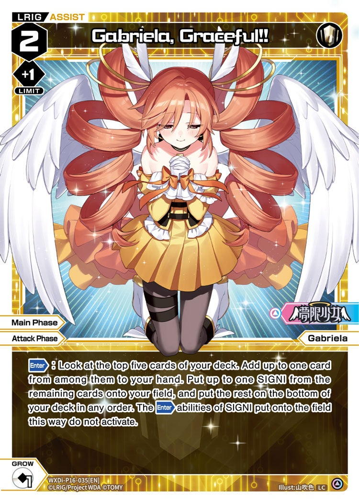

# Gabriela, Graceful!!

## Thông tin lá

| Trường | Giá trị |
| --- | --- |
| Mã in | WXDi-P16-035[EN] |
| Set | WXDi-P16[EN] |
| Số thứ tự | 035 |
| Loại thẻ | ASSIST LRIG |
| Vị trí | LRIG Deck |
| Số bản | — (set booster, không áp dụng) |
| Màu | Trắng |
| Độ hiếm | LC,LC(P) |
| Minh họa | 山吹色 |
| Level | 2 |
| Limit | ＋１ |
| Power | 0 |
| LRIG type / Class | Gabriela |
| Team / Master | MUGEN SHOJO |
| Cost | — |
| Grow cost | 《C》×１ |
| Use timing | Main Phase / Attack Phase |
| Life Burst | Không |

## Card text chính thức

[Enter]: Look at the top five cards of your deck. Add up to one card from among them to your hand. Put up to one SIGNI from the remaining cards onto your field, and put the rest on the bottom of your deck in any order. The [Enter] abilities of SIGNI put onto the field this way do not activate.

## Power text / Life Burst

—

## Ghi chú minh họa
Artist: 山吹色. Ảnh LC được tải từ Card List tiếng Anh.

## FAQ chính thức

— (không có FAQ riêng cho mã này trên trang FAQ tiếng Anh.)

## Ảnh biến thể

- [LC(P)](../images/WXDi-P16-035P-EN.jpg)

## Nguồn
[Card List/FAQ chính thức](https://www.takaratomy.co.jp/products/en.wixoss/card/card.html?card_no=WXDi-P16-035%5BEN%5D ) · [Ảnh thẻ](https://www.takaratomy.co.jp/products/en.wixoss/card/thumb/WXDi-P16-035%5BEN%5D.jpg)
