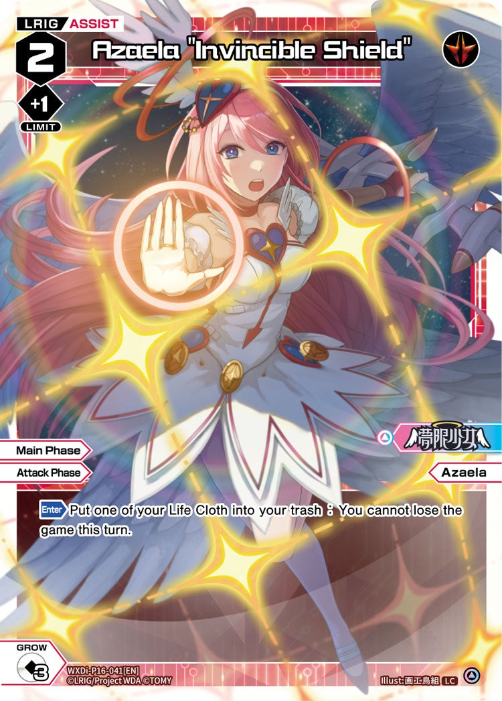

# Azaela "Invincible Shield"

## Thông tin lá

| Trường | Giá trị |
| --- | --- |
| Mã in | WXDi-P16-041[EN] |
| Set | WXDi-P16[EN] |
| Số thứ tự | 041 |
| Loại thẻ | ASSIST LRIG |
| Vị trí | LRIG Deck |
| Số bản | — (set booster, không áp dụng) |
| Màu | Đỏ |
| Độ hiếm | LC,LC(P) |
| Minh họa | 画工鳥組 |
| Level | 2 |
| Limit | ＋１ |
| Power | 0 |
| LRIG type / Class | Azaela |
| Team / Master | MUGEN SHOJO |
| Cost | — |
| Grow cost | 《C》×３ |
| Use timing | Main Phase
Attack Phase |
| Life Burst | Không |

## Card text chính thức

[Enter] Put one of your Life Cloth into your trash: You cannot lose the game this turn.

## Power text / Life Burst

—

## Ghi chú minh họa
Artist: 画工鳥組. Ảnh LC được tải từ Card List tiếng Anh.

## FAQ chính thức

— (không có FAQ riêng cho mã này trên trang FAQ tiếng Anh.)

## Ảnh biến thể

- [LC(P)](../images/WXDi-P16-041P-EN.jpg)

## Nguồn
[Card List/FAQ chính thức](https://www.takaratomy.co.jp/products/en.wixoss/card/card.html?card_no=WXDi-P16-041%5BEN%5D ) · [Ảnh thẻ](https://www.takaratomy.co.jp/products/en.wixoss/card/thumb/WXDi-P16-041%5BEN%5D.jpg)
