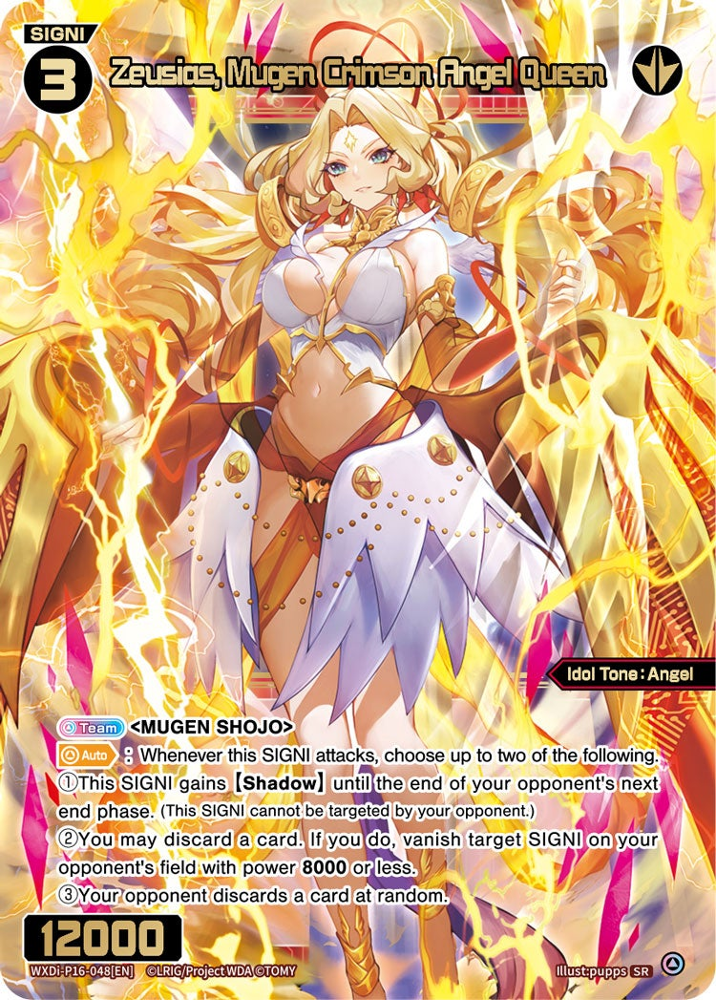

# Zeusias, Mugen Crimson Angel Queen

## Thông tin lá

| Trường | Giá trị |
| --- | --- |
| Mã in | WXDi-P16-048[EN] |
| Set | WXDi-P16[EN] |
| Số thứ tự | 048 |
| Loại thẻ | SIGNI |
| Vị trí | Main Deck |
| Số bản | — (set booster, không áp dụng) |
| Màu | Đỏ |
| Độ hiếm | SR,SRP |
| Minh họa | pupps |
| Level | 3 |
| Limit | — |
| Power | 12000 |
| LRIG type / Class | Idol Tone：Angel |
| Team / Master | — |
| Cost | — |
| Grow cost | — |
| Use timing | — |
| Life Burst | Không |

## Card text chính thức

[Team] <MUGEN SHOJO>
[Team Auto]: Whenever this SIGNI attacks, choose up to two of the following.
①This SIGNI gains 【Shadow】 until the end of your opponent's next end phase. (This SIGNI cannot be targeted by your opponent.)
②You may discard a card. If you do, vanish target SIGNI on your opponent's field with power 8000 or less.
③Your opponent discards a card at random.

## Power text / Life Burst

—

## Ghi chú minh họa
Artist: pupps. Ảnh SR được tải từ Card List tiếng Anh.

## FAQ chính thức

— (không có FAQ riêng cho mã này trên trang FAQ tiếng Anh.)

## Ảnh biến thể

- [SRP](../images/WXDi-P16-048P-EN.jpg)

## Nguồn
[Card List/FAQ chính thức](https://www.takaratomy.co.jp/products/en.wixoss/card/card.html?card_no=WXDi-P16-048%5BEN%5D ) · [Ảnh thẻ](https://www.takaratomy.co.jp/products/en.wixoss/card/thumb/WXDi-P16-048%5BEN%5D.jpg)
