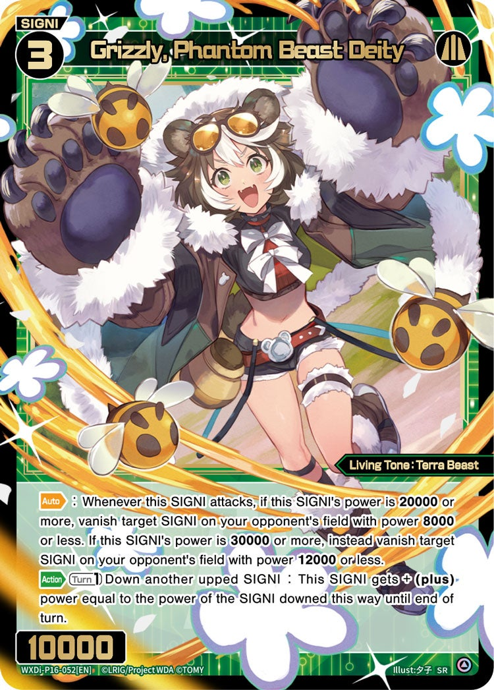

# Grizzly, Phantom Beast Deity

## Thông tin lá

| Trường | Giá trị |
| --- | --- |
| Mã in | WXDi-P16-052[EN] |
| Set | WXDi-P16[EN] |
| Số thứ tự | 052 |
| Loại thẻ | SIGNI |
| Vị trí | Main Deck |
| Số bản | — (set booster, không áp dụng) |
| Màu | Xanh lá |
| Độ hiếm | SR,SRP |
| Minh họa | 夕子 |
| Level | 3 |
| Limit | — |
| Power | 10000 |
| LRIG type / Class | Living Tone：Terra Beast |
| Team / Master | — |
| Cost | — |
| Grow cost | — |
| Use timing | — |
| Life Burst | Không |

## Card text chính thức

[Auto]: Whenever this SIGNI attacks, if this SIGNI's power is 20000 or more, vanish target SIGNI on your opponent's field with power 8000 or less. If this SIGNI's power is 30000 or more, instead vanish target SIGNI on your opponent's field with power 12000 or less.
[Action] {1/Turn} Down another upped SIGNI: This SIGNI gets + (plus) power equal to the power of the SIGNI downed this way until end of turn.

## Power text / Life Burst

—

## Ghi chú minh họa
Artist: 夕子. Ảnh SR được tải từ Card List tiếng Anh.

## FAQ chính thức

— (không có FAQ riêng cho mã này trên trang FAQ tiếng Anh.)

## Ảnh biến thể

- [SRP](../images/WXDi-P16-052P-EN.jpg)

## Nguồn
[Card List/FAQ chính thức](https://www.takaratomy.co.jp/products/en.wixoss/card/card.html?card_no=WXDi-P16-052%5BEN%5D ) · [Ảnh thẻ](https://www.takaratomy.co.jp/products/en.wixoss/card/thumb/WXDi-P16-052%5BEN%5D.jpg)
