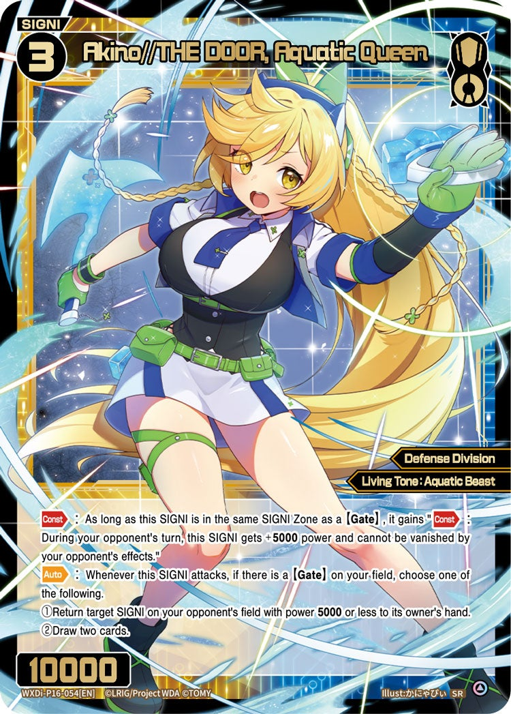

# Akino//THE DOOR, Aquatic Queen

## Thông tin lá

| Trường | Giá trị |
| --- | --- |
| Mã in | WXDi-P16-054[EN] |
| Set | WXDi-P16[EN] |
| Số thứ tự | 054 |
| Loại thẻ | SIGNI |
| Vị trí | Main Deck |
| Số bản | — (set booster, không áp dụng) |
| Màu | Trắng / xanh dương |
| Độ hiếm | SR,SRP |
| Minh họa | かにゃぴぃ |
| Level | 3 |
| Limit | — |
| Power | 10000 |
| LRIG type / Class | Defense Division/Living Tone：Aquatic Beast |
| Team / Master | — |
| Cost | — |
| Grow cost | — |
| Use timing | — |
| Life Burst | Không |

## Card text chính thức

[Constant]: As long as this SIGNI is in the same SIGNI Zone as a 【Gate】, it gains "[Constant]: During your opponent's turn, this SIGNI gets +5000 power and cannot be vanished by your opponent's effects."
[Auto]: Whenever this SIGNI attacks, if there is a 【Gate】 on your field, choose one of the following.
①Return target SIGNI on your opponent's field with power 5000 or less to its owner's hand.
②Draw two cards.

## Power text / Life Burst

—

## Ghi chú minh họa
Artist: かにゃぴぃ. Ảnh SR được tải từ Card List tiếng Anh.

## FAQ chính thức

— (không có FAQ riêng cho mã này trên trang FAQ tiếng Anh.)

## Ảnh biến thể

- [SRP](../images/WXDi-P16-054P-EN.jpg)

## Nguồn
[Card List/FAQ chính thức](https://www.takaratomy.co.jp/products/en.wixoss/card/card.html?card_no=WXDi-P16-054%5BEN%5D ) · [Ảnh thẻ](https://www.takaratomy.co.jp/products/en.wixoss/card/thumb/WXDi-P16-054%5BEN%5D.jpg)
